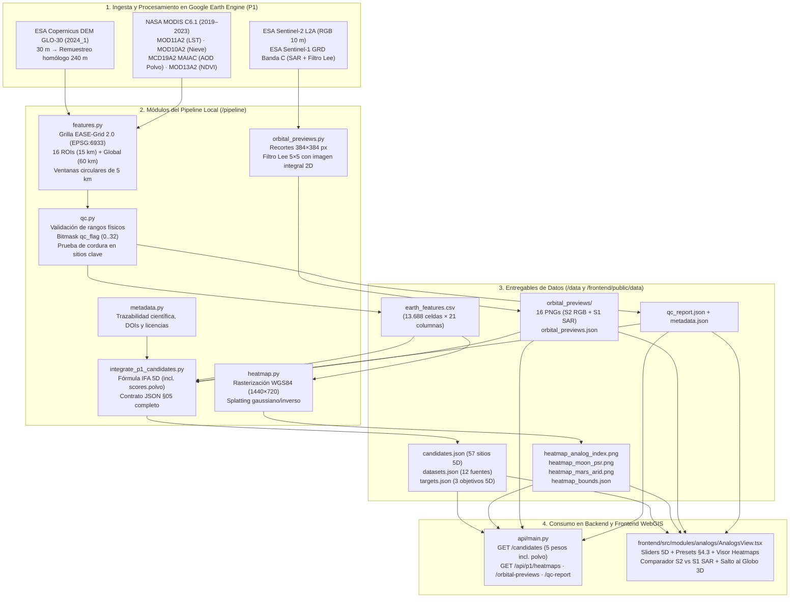

# Documentación Técnica Completa — Rol P1 (Jorge): Ingeniería de Datos Terrestres e Integración

**Proyecto:** TerraAnáloga v2.0 · NASA Space Apps Challenge 2026 (San Salvador)  
**Reto:** *Identify Earth Locations that Analog the Permanent Moon Base Locations and Mars*  
**Responsable P1:** Jorge — Ingeniero de Datos Terrestres y Puente de Integración Geoespacial  
**Rama:** `feature/p1-datos-terrestres` (con respaldo de pipeline puro en `backup/p1-puro`)

---

## 1. Visión General y Propósito de la Parte P1

El rol **P1 (Ingeniero de Datos Terrestres)** es la base empírica sobre la que descansa **TerraAnáloga v2.0**. Su objetivo es medir cuantitativamente la superficie terrestre utilizando observaciones satelitales oficiales de **NASA, ESA, CSA y JAXA** a través de **Google Earth Engine (GEE)**, garantizando que las variables terrestres se calculen a una **escala espacial homóloga** a la de los sensores orbitales planetarios (**LRO LOLA/Diviner** en la Luna y **MGS MOLA / Mars Odyssey THEMIS** en Marte).

Además de construir el pipeline completo en `/pipeline` y generar todos los productos de `/data`, en esta implementación se construyó el **puente de integración (`integrate_p1_candidates.py`)**, la **extensión a 5 dimensiones de la API (`api/main.py`)** y el **Módulo A interactivo del Frontend (`AnalogsView.tsx`)** para conectar de punta a punta las mediciones físicas con la interfaz de usuario.



---

## 2. Decisiones de Ingeniería y Ciencia (Cómo se construyó)

### 2.1. Regla de Escala Homóloga (30 m → 240 m en ventanas de 5 km)
* **Problema físico:** Comparar directamente pendientes calculadas sobre un DEM terrestre de 30 m contra el altímetro láser lunar **LOLA** (~240 m en mapas polares regionales) o el marciano **MOLA** (~240–463 m) produce un sesgo sistemático (las pendientes a 30 m son mucho más altas por rugosidad local).
* **Solución implementada en [features.py](file:///home/jorge/Documents/proyectos/NASA_SPACE/pipeline/features.py#L70-L79):**
  1. Se carga el mosaico global `COPERNICUS/DEM/GLO30_2024_1` (sucesor vigente del deprecado `COPERNICUS/DEM/GLO30`).
  2. Antes de aplicar `ee.Terrain.slope`, se reproyecta explícitamente a **240 m** en la proyección de igual área **NSIDC EASE-Grid 2.0 Global (`EPSG:6933`)**.
  3. Sobre cada centro de celda terrestre se construye un buffer circular de **2.500 m de radio (ventana de 5 km de diámetro)** y se extraen `elev_m` (media), `slope_mean` (media), `slope_p90` (percentil 90) y `relief_local` ($\text{elev}_{\max} - \text{elev}_{\min}$).

### 2.2. Grilla Jerárquica EASE-Grid 2.0 (`EPSG:6933`) y Caché por Teselas
* **Problema de cómputo:** GEE no resuelve el código `EPSG:6933` de forma nativa por código numérico, y muestrear los 149 millones de km² de tierra emergida a 5 km (~5,9 millones de celdas) excede el tiempo y cuota de un hackathon.
* **Solución implementada en [features.py](file:///home/jorge/Documents/proyectos/NASA_SPACE/pipeline/features.py#L34-L39) y [run_pipeline.py](file:///home/jorge/Documents/proyectos/NASA_SPACE/pipeline/run_pipeline.py#L41-L96):**
  1. Se inyectó la definición **OGC WKT completa de `EPSG:6933`** (`Cylindrical_Equal_Area`, paralelo estándar 30°).
  2. Se diseñó un muestreo en **dos niveles jerárquicos**:
     * **Nivel 1 (Densificación fina a 15 km con ventana de 5 km):** Cubre **16 Regiones de Interés (ROIs)** prioritarias en todos los continentes (Valles Secos de McMurdo, Isla Devon/Haughton, Atacama/Puna, Cuenca de Qaidam, Cráter Pingualuit, Tierras Altas de Islandia, Depresión de Danakil, Cinturón Volcánico de Centroamérica, Sahara/Tibesti, Taklamakán/Gobi, Dasht-e Lut en Irán, Desierto del Namib, Cratón de Pilbara en Australia, Svalbard en el Ártico, Mojave/Death Valley y Lanzarote/Teide).
     * **Nivel 2 (Dorsal continental y polar a 60 km con ventana de 5 km):** Cubre las franjas globales para contexto planetario.
  3. Cada tesela descargada se guarda inmediatamente en `data/tiles/<tag>/t_<W>_<S>_<E>_<N>.csv`. Si una corrida se interrumpe, al relanzar se saltan en milisegundos las teselas ya existentes.
  4. **Resultado:** **13.688 celdas únicas** ensambladas con identificador determinista `E{paso}_r{fila}_c{col}`.

### 2.3. Modelado de Sombra Solar en 4 Fechas (`shadow_frac_d1..d4`)
* **Cómo funciona ([features.py](file:///home/jorge/Documents/proyectos/NASA_SPACE/pipeline/features.py#L43-L61) y [L125-L138](file:///home/jorge/Documents/proyectos/NASA_SPACE/pipeline/features.py#L125-L138)):**
  * Se evalúan las 4 fechas cardinales del ciclo orbital terrestre:
    * `d1 = 2024-03-20` ($\delta = 0^\circ$, equinoccio de marzo)
    * `d2 = 2024-06-20` ($\delta = +23,44^\circ$, solsticio de junio)
    * `d3 = 2024-09-22` ($\delta = 0^\circ$, equinoccio de septiembre)
    * `d4 = 2024-12-21` ($\delta = -23,44^\circ$, solsticio de diciembre)
  * Para cada tesela con latitud central $\phi$, se calcula la elevación solar al mediodía local $h = 90^\circ - |\phi - \delta|$ y el azimut ($180^\circ$ o $0^\circ$).
  * Si $h \le 0^\circ$ (noche polar), la fracción de sombra es `1.0` (análogo directo de las Regiones en Sombra Permanente — **PSR** — del Polo Sur Lunar).
  * Si $h > 0^\circ$, se combina la **sombra proyectada a larga distancia** (`ee.Terrain.hillShadow` con ventana de `100 px × 240 m = 24 km`) con la **auto-sombra de ladera** (`ee.Terrain.hillshade <= 0`). A latitudes $|\phi| \gtrsim 65^\circ$ en solsticio de invierno, $h \in (0^\circ, 1,5^\circ]$, reproduciendo exactamente la geometría de iluminación rasante del Polo Sur Lunar (~1,5°).

### 2.4. Climatología MODIS (2019–2023) y Optimización de Memoria en Polvo (MAIAC AOD)
* **Variables extraídas ([features.py](file:///home/jorge/Documents/proyectos/NASA_SPACE/pipeline/features.py#L80-L124)):**
  * **Temperatura Superficial (`MODIS/061/MOD11A2`, 1 km):** `lst_mean` (media día/noche en K), `lst_min` (mínimo nocturno solsticial en K), `lst_max` (máximo diurno solsticial en K) y `lst_amp` (amplitud térmica diurna media Día − Noche en K).
  * **Persistencia de Nieve/Hielo (`MODIS/061/MOD10A2`, 500 m):** `snow_persist` = fracción de compuestos de 8 días con nieve (`Maximum_Snow_Extent == 200`) sobre el total de observaciones válidas.
  * **Carga de Polvo y Aerosoles (`MODIS/061/MCD19A2_GRANULES`, MAIAC 1 km):** `aod_mean` y `aod_p90` (espesor óptico a 550 nm).
    * *Solución técnica clave:* `MCD19A2_GRANULES` almacena gránulos orbitales individuales (más de 1.300 gránulos por tesela polar), lo que causaba `User memory limit exceeded` al calcular el percentil 90 directo. Se resolvió colapsando primero 8 ventanas estacionales representativas con `.mean()` y aplicando `ee.Reducer.percentile([90])` sobre los compuestos estacionales.
  * **Filtro de Vegetación (`MODIS/061/MOD13A2`, 1 km):** `ndvi_mean` y `ndvi_max` para descartar terrenos con biosfera vegetal densa en análogos de superficie lunar/marciana.

---

## 3. Catálogo de Archivos y Cómo Funciona Cada Script

| Archivo | Función Principal | Entradas | Salidas |
| :--- | :--- | :--- | :--- |
| [pipeline/common.py](file:///home/jorge/Documents/proyectos/NASA_SPACE/pipeline/common.py) | Configuración central, carga segura de `.env` (sin imprimir secretos), inicialización de GEE (`High Volume Endpoint`) y constantes de colecciones STAC. | `.env` (`GEE_PROJECT_ID`, `EARTHDATA_TOKEN`) | Objeto `ee` inicializado y loggers en `pipeline/logs/`. |
| [pipeline/smoke_test.py](file:///home/jorge/Documents/proyectos/NASA_SPACE/pipeline/smoke_test.py) | Prueba de humo de conectividad GEE (consulta puntual de DEM + LST en los Valles Secos de McMurdo en < 3 s). | Credenciales GEE | Confirmación en consola y `pipeline/logs/smoke_test.log`. |
| [pipeline/features.py](file:///home/jorge/Documents/proyectos/NASA_SPACE/pipeline/features.py) | Motor de extracción espacial GEE por teselas en proyección EASE-Grid 2.0 (`EPSG:6933`) con `reduceRegions`. | `--bbox`, `--step-km`, `--window-m`, `--tag` | Teselas CSV en `data/tiles/<tag>/` y [data/earth_features_raw.csv](file:///home/jorge/Documents/proyectos/NASA_SPACE/data/earth_features_raw.csv). |
| [pipeline/qc.py](file:///home/jorge/Documents/proyectos/NASA_SPACE/pipeline/qc.py) | Valida rangos físicos plausibles, enmascara valores fuera de rango a `NaN`, asigna el bitmask `qc_flag` y extrae la celda más cercana a los 8 sitios de referencia. | `data/earth_features_raw.csv` | [data/earth_features.csv](file:///home/jorge/Documents/proyectos/NASA_SPACE/data/earth_features.csv) (21 columnas) y [data/qc_report.json](file:///home/jorge/Documents/proyectos/NASA_SPACE/data/qc_report.json). |
| [pipeline/heatmap.py](file:///home/jorge/Documents/proyectos/NASA_SPACE/pipeline/heatmap.py) | Calcula scores preliminares y rasteriza las 13.688 celdas en grillas equirectangulares `EPSG:4326` (`1440×720` px) mediante *splatting* ponderado por distancia inversa. | `data/earth_features.csv` | [heatmap_analog_index.png](file:///home/jorge/Documents/proyectos/NASA_SPACE/data/heatmap_analog_index.png), [heatmap_moon_psr.png](file:///home/jorge/Documents/proyectos/NASA_SPACE/data/heatmap_moon_psr.png), [heatmap_mars_arid.png](file:///home/jorge/Documents/proyectos/NASA_SPACE/data/heatmap_mars_arid.png) y [heatmap_bounds.json](file:///home/jorge/Documents/proyectos/NASA_SPACE/data/heatmap_bounds.json). |
| [pipeline/orbital_previews.py](file:///home/jorge/Documents/proyectos/NASA_SPACE/pipeline/orbital_previews.py) | Descarga recortes ópticos Sentinel-2 RGB sin nubes y radar Sentinel-1 C-Band GRD (VV/HH automático en polos), aplicando el **filtro Lee 5×5** en NumPy puro (usando imágenes integrales 2D). | Coordenadas de los 8 sitios clave | 16 imágenes PNG (`384×384`) + [orbital_previews.json](file:///home/jorge/Documents/proyectos/NASA_SPACE/data/orbital_previews/orbital_previews.json). |
| [pipeline/metadata.py](file:///home/jorge/Documents/proyectos/NASA_SPACE/pipeline/metadata.py) | Genera la documentación estructurada de datasets, DOIs, versiones, protocolo de escala homóloga, geometría solar y desviaciones (D1–D4). | Métricas de corrida | [data/metadata.json](file:///home/jorge/Documents/proyectos/NASA_SPACE/data/metadata.json). |
| [pipeline/integrate_p1_candidates.py](file:///home/jorge/Documents/proyectos/NASA_SPACE/pipeline/integrate_p1_candidates.py) | **Puente P1 → P2/P3/P4:** Calcula las **5 dimensiones del IFA** (`relieve`, `iluminacion`, `frio`, `hielo`, `polvo`), enriquece los 12 sitios curados y descubre las 45 mejores celdas de la grilla cumpliendo el 100 % del contrato §05. | `earth_features.csv`, `orbital_previews.json`, `metadata.json` | [data/candidates.json](file:///home/jorge/Documents/proyectos/NASA_SPACE/data/candidates.json) (57 candidatos 5D) y [data/datasets.json](file:///home/jorge/Documents/proyectos/NASA_SPACE/data/datasets.json) (12 fuentes). |
| [pipeline/run_pipeline.py](file:///home/jorge/Documents/proyectos/NASA_SPACE/pipeline/run_pipeline.py) | Orquestador maestro que ejecuta de principio a fin las ROIs, el ensamblado, el QC, los mapas de calor, la metadata y la integración de candidatos. | Configuración de `PRIORITY_ROIS` | Todos los artefactos actualizados en `/data`. |

---

## 4. Detalle de Algoritmos Clave Implementados

### 4.1. Bitmask de Control de Calidad (`qc_flag` en `qc.py`)
Cada una de las **13.688 celdas** de [data/earth_features.csv](file:///home/jorge/Documents/proyectos/NASA_SPACE/data/earth_features.csv) incluye un entero `qc_flag` formado por suma de potencias de 2:
* `0`: **OK** — Todas las variables presentes y dentro de rangos físicos terrestres (**69,64 %** de las celdas).
* `1`: Cobertura del DEM en la ventana circular menor al 50 % (bordes costeros).
* `2`: Alguna métrica térmica MODIS LST es nula.
* `4`: Persistencia de nieve `snow_persist` nula.
* `8`: Aerosol `aod_mean` / `aod_p90` nulo (ocurre naturalmente sobre hielo antártico/ártico perpetuo de muy alto albedo; por ello `qc_flag in (0, 8)` representa el **71,05 %** de celdas totalmente usables).
* `16`: NDVI nulo (casquetes polares sin vegetación).
* `32`: Valor fuera de rango físico detectado y enmascarado a `NaN` (**0 casos** en la corrida final).

### 4.2. Filtro de Speckle SAR de Lee 5×5 con Imágenes Integrales (`orbital_previews.py`)
Para sustituir operativamente las escenas RADARSAT-1 / RCM en banda C (5,405 GHz) siguiendo el tutorial oficial de la **Agencia Espacial Canadiense (CSA)**:
1. Se consulta `COPERNICUS/S1_GRD` seleccionando automáticamente polarización `VV` o cayendo a `HH` en latitudes polares (Antártida, Devon Island, Pingualuit) donde Sentinel-1 opera en modo polar `HH`.
2. Se convierte la retrodispersión a decibelios ($\sigma^0 \in [-25, 0]\text{ dB}$) y se aplica el filtro adaptativo de Lee en ventana $5 \times 5$:
   $$\hat{I} = \bar{I} + W \, (I - \bar{I}), \qquad W = \frac{\sigma_{\text{local}}^2}{\sigma_{\text{local}}^2 + \sigma_{\text{global}}^2 + \epsilon}$$
3. La media local $\bar{I}$ y la varianza local $\sigma_{\text{local}}^2 = \overline{I^2} - \bar{I}^2$ se calculan en $O(1)$ por píxel usando sumas acumuladas 2D (`cumsum`), generando tanto los PNG en disco como las cadenas `overlay_png_base64` listas para el frontend.

### 4.3. Cálculo de las 5 Dimensiones del Índice de Fidelidad Analógica (`integrate_p1_candidates.py`)
Resuelve el bloqueo que tenía el resto del equipo (donde solo existían 4 dimensiones y faltaba `scores.polvo` en todos los candidatos):
* **`relieve`:** Evalúa la proximidad exponencial de `slope_mean` al perfil objetivo ($12^\circ$ para crestas/cráteres del Polo Sur Lunar, $6,8^\circ$ para llanuras marcianas, $16^\circ$ combinado con `relief_local` para escarpes de tubos de lava).
* **`iluminacion`:** Combina $\max(\text{shadow\_frac}_{d1..d4})$ y la media estacional para premiar sombras rasantes/PSR en `moon_south_pole` e insolación diurna con alta amplitud térmica en `mars_surface`.
* **`frio`:** Normaliza `lst_min` respecto al extremo criosférico natural terrestre (~205 K en Antártida para Luna; ~235 K + amplitud térmica `lst_amp` para Marte).
* **`hielo`:** Combina `snow_persist` (`MOD10A2`), estabilidad térmica y aridez superficial.
* **`polvo`:** Calcula la 5.ª dimensión combinando el espesor óptico de aerosoles de MODIS MAIAC (`aod_mean` y `aod_p90`) con el factor de suelo desnudo ($1 - \text{NDVI}_{\max}$).

---

## 5. Integración con el Backend (`api/main.py`) y Frontend (`AnalogsView.tsx`)

### 5.1. Mejoras realizadas en [api/main.py](file:///home/jorge/Documents/proyectos/NASA_SPACE/api/main.py)
1. **Esquema `Scores` y `CandidateResponse`:** Ahora incluye `polvo`, `orbital_previews` (rutas y estadísticas SAR de los recortes Sentinel-1/2) y `p1_cell_metrics` (las mediciones físicas reales de la celda GEE asociada a cada candidato).
2. **Fórmula `compute_weighted_score` de 5 dimensiones:** `GET /candidates` recibe ahora los 5 pesos dinámicos (`relieve`, `iluminacion`, `frio`, `hielo`, `polvo`) y recalcula `weighted_score` en tiempo real.
3. **Compatibilidad de alias de objetivos (`TARGET_ALIASES`):** Acepta indistintamente `mars` o `mars_surface`, y `moon_lava_tube` o `lava_tubes`, evitando discrepancias entre ramas.
4. **Nuevos endpoints P1 dedicados:**
   * `GET /api/p1/heatmaps`: Devuelve [data/heatmap_bounds.json](file:///home/jorge/Documents/proyectos/NASA_SPACE/data/heatmap_bounds.json) con `LeafletBounds`, `MaplibreCorners` y las 3 capas en base64.
   * `GET /api/p1/orbital-previews`: Devuelve [data/orbital_previews/orbital_previews.json](file:///home/jorge/Documents/proyectos/NASA_SPACE/data/orbital_previews/orbital_previews.json).
   * `GET /api/p1/qc-report`: Devuelve [data/qc_report.json](file:///home/jorge/Documents/proyectos/NASA_SPACE/data/qc_report.json) y [data/metadata.json](file:///home/jorge/Documents/proyectos/NASA_SPACE/data/metadata.json).
   * Montaje estático `/data/*` para servir directamente todos los PNGs de mapas de calor y recortes orbitales.

### 5.2. Implementación del Módulo A en [AnalogsView.tsx](file:///home/jorge/Documents/proyectos/NASA_SPACE/frontend/src/modules/analogs/AnalogsView.tsx)
Se reemplazó el *placeholder* temporal por el buscador completo conectado tanto a la API en vivo (`${API_BASE}/candidates`) como al respaldo estático Plan B (`frontend/public/data/candidates.json`):
* **Botones de Escenarios Rápidos (§4.3):** *Luna Z1 (Crestas iluminadas)*, *Luna Z2 (Mesetas de alunizaje)*, *Luna Z4 (Trampas frías / PSR)*, *Marte (Llanuras áridas y hielo)* y *Subsuelo (Tubos de lava)*.
* **Sliders interactivos de las 5 dimensiones:** Recalculan y reordenan al instante los 57 candidatos según su IFA.
* **Filtro de Descubrimientos (*"Surprise us"*):** Permite aislar los hallazgos poco estudiados (Qaidam, Pingualuit, Puna de Atacama, Complejo Volcánico de El Salvador, Danakil, Dasht-e Lut, Svalbard y las 45 celdas descubiertas por GEE).
* **Visor de Mapas de Calor Globales de P1:** Conmutador entre *Índice Global*, *Luna PSR / Frío* y *Marte Árido / Polvo*, con marcadores clicables posicionados sobre la proyección equirectangular WGS84.
* **Ficha Científica Completa (§05):** Muestra barras 5D, cuadro de mediciones físicas GEE de la celda (`elev_m`, `slope_mean`, `shadow_frac_max`, `lst_min`, `snow_persist`, `aod_p90`, `ndvi_max`), **comparador visual lado a lado Sentinel-2 RGB vs. Sentinel-1 SAR (Filtro Lee)**, propiedades vs. procesos físicos, límites terrestres, aplicaciones de exploración, astrobiología y un botón **"Abrir en Globo 3D / Explorador"** que sincroniza el `BBox` con `useExplorerStore` y salta al globo interactivo.

---

## 6. Guía Rápida de Ejecución y Verificación

### 6.1. Ejecutar o actualizar el pipeline terrestre P1
```bash
# 1. Prueba rápida de conectividad GEE (~3 s)
./pipeline/.venv/bin/python pipeline/smoke_test.py

# 2. Ejecutar el pipeline completo (usa caché en data/tiles/ y regenera CSV, QC, heatmaps, metadata y candidates.json)
./pipeline/.venv/bin/python pipeline/run_pipeline.py

# 3. Verificar que los 57 candidatos cumplen el 100 % del contrato §05 (0 campos faltantes)
./pipeline/.venv/bin/python pipeline/normalizar_contrato.py --check
```

### 6.2. Levantar el Backend unificado y el Frontend WebGIS
```bash
# Terminal 1 — Iniciar la API FastAPI (con MongoDB Atlas o Fallback Local Automático)
uvicorn api.main:app --reload --port 8000

# Terminal 2 — Iniciar el Frontend WebGIS (React + TypeScript + Vite)
cd frontend
pnpm install
pnpm dev
```

