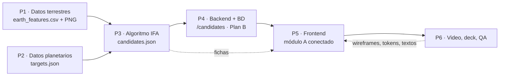

# T4 · Cronograma y check-ins (H0–H24)

**Estado:** propuesta P6 para revisión del PM · **Fecha:** 2026-11-14
Fuentes: plan maestro §06 y §07, plan P5 §7 (casillas de fases), §9.1–§9.2 y §10, plan P6 §2. No se inventan horas del reloj: **`PENDIENTE: hora real de H0 (inicio del reto) — coordina P6 con el equipo`**. Todo está en horas relativas (H0 = arranque).

**Roles** (alias del README y del plan maestro): **P1** Jorge (datos terrestres) · **P2** Ansorje (datos planetarios) · **P3** Abel (algoritmo y fichas) · **P4** Anthony (backend y base de datos) · **P5** Amiguito (frontend WebGIS) · **P6** Paola (UI/UX, coordinación y pitch; sus tareas están delegadas al orquestador `nasa-space-7f`, con P5 como PM).

---

## 1. Cadena de dependencias entre roles



| Quien espera | Necesita de | Entregable | Hora límite | Si no llega (plan de contingencia) |
| :--- | :--- | :--- | :--- | :--- |
| P3 | P1 | `earth_features.csv` y mapa de calor PNG | H6 (parte de H4–H8) | Plan maestro §07: pasar la grilla de 5 km a 15 km |
| P3 | P2 | `targets.json` (perfil: media, p10 y p90) | H4 | Perfil mínimo de 3 dimensiones (Relieve, Frío, Hielo) |
| P4 | P3 | `candidates.json` (≈ 2.000 celdas) | H8 | Seguir con datos *mock* con el mismo contrato |
| P5 | P4 | `/candidates`, `/candidates/near`, `/targets` y `/export` (**ya existen** en la app unificada `backend/main.py`, que monta `backend/mongo_api.py`; `c3e2be9` y `7f0968a`), **con datos que cumplan el contrato §05** (B34/B35) y `candidates.json` estático generado con `/export` (B38) | H8 (`/candidates/near`: H16–H20) | P5 trabaja con `candidates.mock.json` solo para desarrollo y pruebas; cuando se construya el adaptador (B37, **todavía no existe**) descartará y contará los documentos inválidos; el módulo B sostiene la demo de datos |
| P5 | P4 | ~~**D7:** una sola aplicación FastAPI y un solo `requirements.txt`; `.env.example` con `MONGO_URI` (B32, B33)~~ **RESUELTO** en `7f0968a`: una sola app, un solo `requirements.txt` y `.env.example` en la raíz. El frontend usa **una sola URL** (`VITE_API_BASE`); `VITE_DATA_API_BASE` ya no aplica | — | — |
| P5 | P3 | Fichas redactadas | H16 | Ficha con "Pendiente" en cada campo ausente (no se oculta) |
| P5 | P1/P2 | Pares de imágenes del comparador (Top 5) | H20 | El comparador se oculta si falta el par |
| P5 | P6 | Wireframes (H3), paleta y tipografía (H4), textos ES/EN (H10) | según columna | Claves con texto provisional `TODO:` que no rompen la UI |
| P6 | P5 | URL de vista previa en Vercel por PR (continuo) y demo estable para grabar (H20) | H20 | Versión local de respaldo (`pnpm build` y `pnpm preview`) |
| Todos | P4 | URL de Render activa | H1–H4 | Abrir la URL 3 minutos antes de presentar; si falla, el interruptor de Plan B |

---

## 2. Franjas y checkpoints

Cada checkpoint tiene un **criterio verificable** (algo que se puede comprobar con una URL, un archivo, un comando o una prueba), la persona que lo comprueba y la acción si falla. Las horas siguen el plan maestro §06.

### H0 – H1 · Arranque y alcance

| Rol | Qué hace |
| :--- | :--- |
| P6 | Abre el canal del equipo y la bitácora de IA ([registro-ia.md](registro-ia.md), T7) |
| P1/P2 | Verifican accesos: Earthdata, CDSE, G-Portal y PDS |
| P3/P4 | Fijan el contrato JSON |
| P4 | Crea el repositorio y la base de datos |
| P5 | Merge de `back-AR` en `Frontend/WebGIS` y base técnica |

**Criterio de salida (H1):** (1) repositorio creado; (2) los 4 accesos confirmados por escrito en el canal; (3) contrato JSON congelado y guardado en el repo (el esquema de candidato del plan maestro §05); (4) decisiones D1–D6 anotadas en `frontend/README.md` o en el plan P5. *Verifica: P6.*

### H1 – H4 · Construcción en paralelo (Fase 1)

| Rol | Qué hace |
| :--- | :--- |
| P1 | Grilla terrestre (~5 km), pendientes con Copernicus DEM a escala homóloga, sombra solar en 4 fechas y carga de polvo (MODIS AOD) |
| P2 | Perfil estadístico (media, p10, p90) del Polo Sur lunar y de Marte |
| P3 | Script de similitud con datos simulados |
| P4 | API FastAPI con datos *mock* desplegada en Render |
| P5 | Módulo B refactorizado; módulo A con candidatos *mock*; despliegue en Vercel |
| P6 | **Wireframes (H3)** y **paleta, tipografía y espaciado (H4)** |

### ⛳ Checkpoint H4

| Criterio verificable | Cómo se comprueba | Responsable |
| :--- | :--- | :--- |
| `targets.json` real existe en el repo con los 3 perfiles (`moon_south_pole`, `mars_surface`, `lava_tubes`) | Abrir el archivo | P2 |
| La API *mock* en Render responde a una petición de prueba | Abrir la URL de Render y ver respuesta 200 | P4 |
| La app en Vercel abre y muestra los dos módulos | Abrir la URL de Vercel | P5 |
| `pnpm build` y `pnpm test` pasan en la rama | Ejecutar ambos comandos | P5 |
| `docs/p6/wireframes.md` y `design-tokens.md` entregados | Existen los archivos y el PM los aceptó | P6 |

*Si falla:* el responsable lo declara en el canal y se aplica la columna "Si no llega" de la tabla de dependencias.

### H4 – H8 · Procesamiento real e integración

| Rol | Qué hace |
| :--- | :--- |
| P1 | Añade MODIS LST, nieve MODIS/JAXA y filtro NDVI; exporta `earth_features.csv` y mapa de calor PNG |
| P3 | Ejecuta el algoritmo real para la Luna y Marte; genera `candidates.json` |
| P4 | Carga `candidates.json` en la base y genera el archivo estático de respaldo (Plan B) |
| P5 | `lib/ifa.ts` con pruebas, `presets.ts`, `WeightSliders`, `RadarCompare` y `CandidateCard` |
| P6 | Maqueta de la ficha y del orden de lectura (ya cubierta en T1) |

### ⛳ Checkpoint H8

| Criterio verificable | Cómo se comprueba | Responsable |
| :--- | :--- | :--- |
| `earth_features.csv` publicado (señal de alerta del plan maestro: a H6 no existe → pasar a grilla de 15 km) | Abrir el archivo | P1 |
| `/candidates` devuelve documentos que **cumplen el contrato §05 con coordenadas terrestres** (no basta con que la API responda: hoy los datos de `seed_mongo.py` son de Marte y la Luna y no traen `scores`, B34) | Petición a `/candidates` y validación con el adaptador `lib/candidateAdapter.ts` (**todavía no existe, B37**); cuando exista, acepta los documentos y el contador de descartados es 0 (o conocido). Mientras tanto, revisión manual de los campos del contrato | P3 + P4 (datos) · P5 (adaptador) |
| `/targets` con los 3 identificadores (`moon_south_pole`, `mars_surface`, `lava_tubes`) y el perfil de 5 dimensiones (B35) | Petición a `/targets` | P2 + P3 |
| Archivo estático de respaldo (Plan B) generado con `GET /export` y guardado como `public/data/candidates.json` (B38) | Existe en el repo y la app lo carga cuando se bloquea la API | P4 + P5 |
| El IFA del frontend coincide con el de P3 en 5 casos fijos, diferencia ≤ 0,001 | Pruebas Vitest de `ifa.ts` en verde | P5 + P3 |
| Presets suman 1,0 y coinciden con el plan maestro §4.3 | Revisión cruzada (P5 §8) | P5 + P3 |
| "Luna Z4" y "Marte" producen un Top 10 distinto | Comparar ambos listados | P5 |

### H8 – H12 · Validación científica y demo completa

| Rol | Qué hace |
| :--- | :--- |
| P3 | **Prueba de cordura** (McMurdo y Devon en el Top 20) y elige 4 descubrimientos poco estudiados |
| P5 | Vista polar/3D, selector ES/EN, cámaras, filtro de descubrimientos y puente A → B |
| P6 | **Textos finales ES/EN (entrega H10)** |

### ⛳ Checkpoint H12 — CRÍTICO

| Criterio verificable | Cómo se comprueba | Responsable |
| :--- | :--- | :--- |
| La aplicación funciona de punta a punta | Pasa el **guion de demo completo** (P5 §9.3, 9 pasos) en la URL de Vercel, en **ES y EN**, con **API y en modo estático** | P5 + P6 |
| McMurdo y Devon aparecen en el Top 20 con el preset por defecto | Ver el listado | P3 |
| 4 descubrimientos seleccionados y marcados | Filtro "Solo descubrimientos" muestra al menos 4 | P3 |
| Tabla de métricas de P5 §9.1 completa | Rellenar la tabla con los resultados reales | P5 |
| Textos ES/EN sin claves faltantes | `pnpm test` en verde (prueba de paridad) | P6 |
| 0 errores en consola | Playwright o revisión manual | P5 |

*Si falla (plan maestro §07):* si McMurdo/Devon no están en el Top 20, calibrar los parámetros σ<sub>d</sub> o activar el modo robusto de 3 dimensiones. Si la demo no pasa, **se corrige antes de dormir**: nadie sale a descansar con el checkpoint en rojo.

### H12 – H16 · Descanso escalonado y usabilidad

Dos turnos de descanso, **mínimo 3 personas activas** en todo momento.

| Rol | Qué hace |
| :--- | :--- |
| P3 | Redacta las fichas detalladas (procesos, usos, biofirmas y límites) |
| P6 | **Prueba de usabilidad con 3 personas ajenas al equipo (entrega H14)** ([prueba-usabilidad.md](prueba-usabilidad.md), T8) |
| P5 | Turno de descanso; después corrige los hallazgos de prioridad alta |

### ⛳ Checkpoint H16

| Criterio verificable | Cómo se comprueba | Responsable |
| :--- | :--- | :--- |
| Fichas terminadas para los 4 descubrimientos y los sitios del Top 5 | Cada ficha contiene los 6 campos del contrato (`similar_properties`, `similar_processes`, `differences_and_limits`, `exploration_use_cases`, `subsurface_and_biology`, `datasets_used`) | P3 |
| Resultado de la prueba de usabilidad registrado con lista de hallazgos priorizada | Hoja de registro completa de 3 personas | P6 |
| Hallazgos de prioridad alta, corregidos o con responsable y hora | Lista en el canal | P5 |
| **Desde aquí, todo bug nuevo es una señal de alerta** (plan maestro §07: bugs después de H16) | — | Todos |

### H16 – H20 · Enriquecimiento visual y zoom regional

| Rol | Qué hace |
| :--- | :--- |
| P1/P2 | Pares de imágenes para los mejores candidatos; perfil del pozo de *Mare Tranquillitatis* frente a tubos de lava de Centroamérica |
| P4 | Endpoint `/candidates/near` |
| P5 | Comparador lado a lado, interruptor de respaldo estático y carga diferida |
| P6 | QA visual a 1280 y 375 px |

### ⛳ Checkpoint H19 (repetición completa) → H20 CONGELAMIENTO

| Criterio verificable | Cómo se comprueba | Responsable |
| :--- | :--- | :--- |
| Tabla de métricas de P5 §9.1 repetida y en verde | Mismos pasos que en H12 | P5 |
| Cada ficha del Top 5 tiene su comparador (o se oculta sin dejar hueco) | Abrir las 5 fichas | P5 |
| No quedan hallazgos de usabilidad de prioridad alta abiertos | Lista del checkpoint H16 | P6 |
| QA visual a 1280 y 375 px: sin desplazamiento horizontal | Capturas a ambos anchos | P6 |
| **H20: código congelado.** Se crea una etiqueta (`tag`) del commit; solo se aceptan correcciones **bloqueantes**, con PR revisado | `git tag` visible en el repositorio | P5 |

### H20 – H23 · Congelamiento, video y documentación

| Rol | Qué hace |
| :--- | :--- |
| P5/P6 | Graban la demo en pantalla, editan el video (≤ 30 s) y cierran el deck de 7 diapositivas |
| P2/P3/P4 | Documentación técnica, tabla de fuentes y licencias, declaración de uso de IA |
| P6 | Registro de uso de IA completo (P5 aporta sus entradas) |

### ⛳ Checkpoint H22 — lista previa a la demo (P5 §9.5)

- [ ] URL de Render abierta 3 minutos antes; indicador "API" en verde.
- [ ] Interruptor de Plan B probado.
- [ ] Fechas GIBS fijas y capas cargando.
- [ ] 0 errores en la consola.
- [ ] Versión local de respaldo: `pnpm build` y `pnpm preview` funcionan.
- [ ] Atribuciones NASA, ESA, JAXA y CSA visibles (y Esri si se usa).
- [ ] Video ≤ 30 s, deck de 7 diapositivas y registro de IA en la carpeta de entrega.
- [ ] Ni el video ni el deck dicen que el procesamiento usa datos reales del BBox ni que el módulo A funciona si no es cierto.

### ⛳ H23 – H24 · Envío

| Criterio verificable | Cómo se comprueba | Responsable |
| :--- | :--- | :--- |
| Proyecto cargado en la plataforma de NASA Space Apps **antes de las 11:59 p. m.**, con margen de seguridad | Captura de la confirmación de envío | P6 + P4 |
| Los enlaces enviados abren en una ventana de incógnito | Probarlos | P6 |

---

## 3. Estado real del frontend hoy (14-nov-2026)

Tomado de las casillas del plan P5 §7 y de las entregas de P6 reportadas por el PM en esta sesión. `[x]` = hecho; `[ ]` = pendiente. No se estima un porcentaje de avance sin respaldo.

| Fase | Tarea | Resp. | Estado |
| :--- | :--- | :--- | :--- |
| 0 | Cerrar D1–D6 en reunión de 15 min | P6 | `[ ]` — D1 y D3 se trabajan con la recomendación; el equipo no ha cerrado nada |
| 0 | Merge de `back-AR` (`f8ba6fc`) | P5 | `[x]` |
| 0 | pnpm 12, TypeScript 7 con `allowJs`, Tailwind 4 y `.env.example` | P5 | `[x]` |
| 0 | Proyecto en Vercel con vista previa por PR | P5 | `[ ]` |
| 0 | Wireframes de A y B | P6 | Entregada (T1): **aceptada con cambios menores** por el PM. La casilla del plan sigue sin marcar |
| 1 | Módulo B refactorizado (`modules/explorer/`, `api/`, store, i18n) | P5 | `[x]` — 35 pruebas Vitest en verde (el plan dice 27; el PM verificó 35) |
| 1 | Globo 3D (three.js) para Tierra, Luna y Marte | P5 | `[x]` (implementado, ver `frontend/README.md`; el plan P5 §3 lo marca en D2) |
| 1 | Módulo A con globo y candidatos *mock* | P5 | `[ ]` — la pestaña muestra "en construcción" |
| 1 | `candidates.ts` con respaldo estático y `DataSourceToggle` | P5 | `[ ]` |
| 1 | Paleta, tipografía y espaciado | P6 | Entregada (T2): **aceptada**. `ink-muted` → `#a3b1c6` aplicado en `index.css`; `accent` sin cambios; correcciones de clases en el backlog de P5 (B27–B31) |
| 2 | `lib/ifa.ts`, `presets.ts`, `WeightSliders`, `RadarCompare`, `CandidateCard` | P5 | `[ ]` |
| 2 | `LayerPanel` con capas GIBS | P5 | `[ ]` |
| 2 | Módulo B: B3, B6, B7, B8, B9, B15, B18 | P5 | `[x]` — se adelantaron en la Fase 1 (plan P5 §7) |
| 3 | `useT()` y textos finales ES/EN | P5/P6 | Textos revisados (T3): **aceptados con cambios menores**; claves del módulo A propuestas, sin integrar |
| 4 | Prueba de usabilidad con 3 personas | P6 | `[ ]` — protocolo en T8 (pendiente) |
| 5–6 | Comparador, `/candidates/near`, carga diferida, QA visual, congelamiento | P5/P6 | `[ ]` |
| — | Backend: `/candidates`, `/candidates/near`, `/targets` y `/export` | P4 | **Existen** en la app unificada (`7f0968a`), pero sus datos **no cumplen el contrato §05** (B34/B35): sin `scores` ni ficha, y los 3 "candidatos" son lugares de Marte y la Luna. No se pudo probar contra Atlas (no hay `MONGO_URI` en la máquina del frontend) |
| — | Unir las dos APIs en una sola aplicación con un solo `requirements.txt` (D7, B32) | P4 | `[x]` — `7f0968a` (`backend/main.py` monta `backend/mongo_api.py`). También resuelto B36 (`test_db.py`) y B13 (README del backend) |
| — | `.env.example` con `MONGO_URI` (B33) | P4 | `[x]` — en la raíz del repo (`7f0968a`) |
| — | `candidates.json` real con el contrato §05 cargado en Mongo | P3/P4 | `[ ]` — `PENDIENTE: fecha de entrega — P3/P4` |
| — | NASA CMR devuelve siempre lista vacía; PDS no trae productos (B10) | P4 | Pendiente de P4 |

**Lectura para el PM:** el módulo B (explorador) está terminado y probado de punta a punta contra el backend local; el módulo A, que es el núcleo del reto, **no ha empezado** y depende de **datos reales de P3 cargados en Mongo con el contrato §05** (P3/P4): la API ya existe, pero hoy no alimenta el IFA. El cuello de botella pasó de "falta la API" a "faltan los datos". Es el principal riesgo de plazo.

---

## 4. Plantilla de check-in de 2 minutos

Se hace **cada 4 horas** (en los checkpoints) y siempre que alguien se desbloquee. Una persona por vez, máximo 30 segundos. P6 anota en el canal.

```
CHECK-IN · H__ · Rol: P_ · Nombre: ________
1. HECHO (desde el último check-in; con prueba: URL, archivo o commit)
   - ...
2. SIGUIENTE (lo próximo que haré, con hora estimada)
   - ...
3. BLOQUEOS (qué necesito, de quién y para cuándo)
   - Necesito ___ de P_ antes de H__ / Ninguno
4. SEÑAL: 🟢 al día · 🟡 en riesgo · 🔴 bloqueado
```

Reglas: (1) "hecho" solo cuenta si hay prueba; (2) un bloqueo sin responsable y hora no es un bloqueo, es una queja; (3) 🔴 dispara la **acción inmediata del plan maestro §07** sin discusión; (4) el moderador (P6) corta a los 30 s por persona.

### Registro de check-ins

| H | Rol | Hecho | Siguiente | Bloqueos | Señal |
| :-: | :-: | :--- | :--- | :--- | :-: |
| | | | | | |

---

## 5. Riesgos de plazo y su acción inmediata (resumen del plan maestro §07 y P5 §10)

| Señal | Acción inmediata |
| :--- | :--- |
| A H2 no hay archivos de PDS, G-Portal o RADARSAT-1 | Usar productos preprocesados de Google Earth Engine / PDS QuickMap y documentar |
| A H6 no existe `earth_features.csv` | Grilla de 15 km o prefiltrar regiones áridas, de alta montaña y latitudes > 50° |
| Falla la prueba de cordura en H10 | Calibrar σ<sub>d</sub> o activar el modo robusto de 3 dimensiones |
| La demo tarda más de 15 s en cargar datos | Abrir la URL de Render 3 minutos antes; interruptor de Plan B |
| Bugs después de H16 | Congelar a H20 y dedicar las últimas 3 horas a narrativa, video y envío |
| A H8 `/candidates` no devuelve documentos que cumplan el contrato §05 con coordenadas terrestres | Seguir con `candidates.mock.json` **solo para desarrollo** (nunca en la demo, D8); el módulo B sostiene la demo de datos |
| Textos de P6 tarde | Claves provisionales `TODO:`; P6 los sustituye sin tocar código |

---

## 6. Autoevaluación contra los criterios de aceptación de T4

| Criterio | Cumple | Dónde |
| :--- | :--- | :--- |
| Franjas H0–H24 del plan maestro con responsable por rol | Sí | §2 (una tabla de roles por franja) |
| Checkpoints H4, H8, H12, H16, H20 (congelamiento) y H23 (envío) | Sí; además H19 y H22 | §2 |
| Cada checkpoint con criterio verificable ("no avanzar en X") | Sí: columna "Cómo se comprueba" y responsable en cada uno | §2 |
| Plantilla de check-in de 2 minutos (hecho / siguiente / bloqueos) | Sí | §4 |
| Estado real del frontend tomado del plan P5 §7 | Sí; con las fases y los resultados de las entregas P6 | §3 |
| Dependencias entre roles marcadas (P1/P2 → P3 → P4 → P5) | Sí; diagrama y tabla con hora límite y contingencia | §1 |
| Sin datos inventados | Sí: la hora real de H0 y las fechas de P3/P4 están como `PENDIENTE` | cabecera, §3 |

### Dudas abiertas
1. **`PENDIENTE: hora real de H0`** (la fija el equipo); con ella se pueden poner las horas del reloj.
2. **`PENDIENTE: fecha de entrega del candidates.json real cargado en Mongo con el contrato §05`** (P3/P4); condiciona el checkpoint H8. **Actualización S3:** la API ya existe y está unificada en una sola app y una sola URL (`7f0968a`; D7, B32, B33, B36 y B13 resueltos); el cuello de botella sigue siendo **B34** (datos reales §05) y **B37** (adaptador, sin hacer).
3. En §3, la fila "Globo 3D" se tomó del README y del plan P5 §3 (D2), no de una casilla del plan; el PM puede marcarla en la sección 7.
