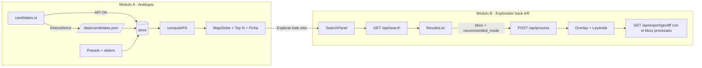

# Frontend WebGIS (P5 + P6): Plan de Desarrollo, Análisis y Evaluación de Calidad

**Proyecto:** TerraAnáloga v2.0 · NASA Space Apps 2026 — San Salvador
**Equipo frontend:** P5 AMIGUITO (desarrollo WebGIS) + P6 PAOLA (UI/UX, textos, coordinación y pitch)
**Rama de trabajo:** `Frontend/WebGIS` · **Gestor de paquetes:** `pnpm` (obligatorio; no usar `npm` ni `yarn`)
**Fuentes:** [plan maestro](plan_maestro_terraan_loga_v2_0_hackathon_24h.md) · informe de la rama `back-AR` (14-nov-2026, commit `f87dc3e`)

> Versiones de librerías y capas GIBS verificadas el 2026-11-14 (registro de paquetes y `WMTSCapabilities.xml` de GIBS). El código de `back-AR` y `feature/database` se leyó completo tras el `git fetch` del 14-nov (último commit remoto: `f87dc3e`, 17:25).

---

## 1. Alcance y reparto P5 / P6

El frontend es **responsabilidad completa del equipo P5 + P6**. P5 programa; P6 decide la experiencia y el contenido. **P5 no redacta textos finales ni cambia el diseño aprobado sin P6**, y P6 no tiene que tocar código.

| Área | P5 (desarrollo) | P6 (UI/UX y contenido) |
| :--- | :--- | :--- |
| Wireframes y flujo de pantallas | Revisa si es viable técnicamente | **Dueña**: diseña y aprueba |
| Estilo visual (colores, tipografía, espaciado) | Lo implementa como *tokens* de Tailwind | **Dueña**: define la paleta y la jerarquía |
| Textos de la interfaz ES/EN | Crea las claves en `i18n/` con texto provisional `TODO:` | **Dueña**: redacta y traduce el texto final |
| Fichas científicas (contenido) | Las muestra desde los datos | Revisa la legibilidad junto con P3 (autor científico) |
| Mapa, capas, sliders, radar, comparador | **Dueño** | Valida la usabilidad |
| Integración con la API y Plan B | **Dueño** | — |
| Pruebas automáticas | **Dueño** | — |
| Pruebas de usabilidad y QA visual | Corrige lo que salga | **Dueña**: ejecuta y registra |
| Video ≤ 30 s, deck de 7 diapositivas, guion | Graba la pantalla y deja la demo estable | **Dueña** |
| Registro de uso de IA | Anota sus usos de IA en la bitácora | **Dueña** de la bitácora |
| Control de tiempos (*check-ins*) | Reporta su avance | **Dueña** |

**Puntos de entrega P6 → P5:** wireframes (H3), paleta y tipografía (H4), textos ES/EN completos (H10), resultado de la prueba de usabilidad (H14).
**Puntos de entrega P5 → P6:** URL de vista previa en Vercel en cada PR, demo estable para grabar (H20).

---

## 2. Situación real del repositorio

### 2.1 Estado de las ramas (revisado el 14-nov-2026 tras `git fetch`)

| Rama | Último commit | Qué contiene | Relevancia para el frontend |
| :--- | :--- | :--- | :--- |
| `Frontend/WebGIS` (la nuestra) | `47cfe92` 16:44 | Igual que `main`: plantilla de Vite + backend MVP antiguo | Base de trabajo; **aún no se ha hecho merge de nada** |
| `main` | `47cfe92` 16:44 | README con roles y plan maestro | — |
| `back-AR` | `f87dc3e` 17:25 | Backend v0.3.0 + `App.jsx` con Leaflet | **Alta**: es el backend real de hoy (ya hay una copia local de esta rama) |
| `feature/database` | `8b18173` 16:31 | `docker-compose` con PostGIS 16 + MinIO + Adminer, tabla `stac_items`, `seed.py` | Media: todavía **no hay tabla de candidatos** ni API que la lea |
| `develop` | `dcb6576` 15:54 | Versión anterior de `back-AR` + `feature/database` | Desactualizada |
| `datos-planetarios` | `394b79d` 16:42 | Igual que `main` (sin datos planetarios todavía) | Ninguna por ahora |

### 2.2 Qué trae `back-AR` (código leído completo)
- **Backend FastAPI v0.3.0**, repartido en `main.py` (rutas), `connectors.py` (búsqueda federada) y `processor.py` (procesamiento). Tiene 3 endpoints: `GET /api/search`, `POST /api/process` y `GET /api/export/geotiff` (contrato en la sección 4.2).
- **`connectors.py`:** consulta en paralelo NASA CMR y Copernicus STAC (Sentinel-2 L2A y Sentinel-1 GRD) para la Tierra, y PDS ODE para la Luna y Marte. Además tiene un catálogo fijo de 6 datasets de agencias asociadas. Si una fuente falla, **la omite sin avisar**.
- **`processor.py`:** siempre lee 4 GeoTIFF de `backend/sample_data/` (el NDWI usa el mismo archivo óptico que el NDVI); si no los encuentra, genera un patrón sintético (`source_file = "cloud_stream_model"`). Colorea con 4 paletas: `radar`, `ndvi`, `precip` y `thermal`. **El bbox no recorta nada**: solo indica dónde colocar la imagen.
- **`frontend/src/App.jsx` (393 líneas, un solo componente):** React + `react-leaflet` 5, estilos inline, JS. Vistas Tierra (EPSG:3857, base Esri + MODIS de GIBS con fecha por defecto `2024-08-15`), Luna y Marte (EPSG:4326, teselas Trek). El mapa se vuelve a montar al cambiar de cuerpo.
- **Merge:** reescribe `frontend/` (~500 líneas de diferencia) y **borra `frontend/.gitignore`**. No es grave porque el `.gitignore` de la raíz ya ignora `node_modules/`, `dist/` y `.env`, pero **habrá conflictos**.

### 2.3 `feature/database` (código leído completo)
- PostGIS con una sola tabla, `stac_items` (footprint `GEOMETRY(4326)` con índice GIST). `seed.py` carga 15 escenas de Sentinel-2 de **Buenos Aires** desde Microsoft Planetary Computer.
- **No guarda candidatos análogos ni puntuaciones IFA**, y ningún endpoint de FastAPI la consulta todavía. Para el frontend no cambia nada por ahora: seguimos dependiendo de `candidates.json`.
- Las credenciales están escritas directamente en `docker-compose.yml` y `seed.py`. Sirve para uso local, pero no para desplegar.

### 2.4 Divergencia con el plan maestro

| Plan maestro | `back-AR` hoy |
| :--- | :--- |
| MongoDB Atlas `2dsphere` | Sin base de datos (`feature/database` usa PostGIS, solo con escenas STAC) |
| `/candidates`, `/candidates/near`, `/targets` | `/api/search`, `/api/process`, `/api/export/geotiff` |
| IFA con sliders y presets por zona | No existe |
| Fichas de candidatos análogos | No existen |
| React + TS + Tailwind + MapLibre + Recharts | React JS + Leaflet, estilos inline |
| Plan B estático `candidates.json` | No existe |

**Consecuencia:** si seguimos solo el plan maestro, hoy no hay backend que alimente el buscador. Si seguimos solo `back-AR`, el producto es un visor de teledetección y **no responde al reto** (encontrar análogos terrestres).

---

## 3. Decisiones que hay que cerrar en H0–H1

| # | Decisión | Recomendación | Quién decide |
| :--- | :--- | :--- | :--- |
| **D1** | ¿Qué producto mostramos? | **Uno con dos módulos:** **A · Buscador de análogos** (núcleo del reto: IFA, presets, fichas, radar, comparador; datos de `candidates.json`) y **B · Explorador de datos** (lo de `back-AR`: búsqueda federada, procesamiento SAR/NDVI/NDWI/Diviner/precipitación, descarga GeoTIFF). El módulo B demuestra el uso real de datos NASA/ESA/JAXA/CSA y no se desperdicia el trabajo del backend. | Todo el equipo (P4 + P3 + P5/P6) |
| **D2** | Mapa | **Implementado en el módulo B:** **globo 3D con three.js** para la Tierra, la Luna y Marte (vista por defecto), con textura equirectangular: una 2K local en `public/textures/` (instantánea y sin red) y encima teselas en vivo de GIBS/Trek a 4K. Se mantiene **Leaflet como "Mapa 2D"** para el detalle. MapLibre no hace falta para los globos (no lee las teselas EPSG:4326 de Trek); queda como opción para el mapa del módulo A. | P5 (informa al equipo) |
| **D3** | ¿Dónde se calcula el IFA? | **En el navegador**, a partir de los `scores` de cada candidato. Así es instantáneo y el Plan B funciona entero. | P3 + P4 + P5 |
| **D4** | ¿TypeScript + Tailwind? | **Sí, de forma gradual:** `allowJs`, los archivos nuevos en `.tsx` y el `App.jsx` de `back-AR` se migra al partirlo en componentes. | P5 |
| **D5** | Merge de `back-AR` | **Merge de `back-AR` en `Frontend/WebGIS` en H0–H1**, antes de reestructurar. Desde ese momento, **el backend no toca `frontend/`**. | P4 + P5 |
| **D6** | Base de datos del módulo A | La rama `feature/database` ya eligió **PostGIS**. Pedir a P4 una tabla `candidates` (punto `geography` + `scores` JSONB) que alimente `/candidates` y `/candidates/near` (`ST_DWithin`). El frontend solo exige el contrato JSON del candidato y un `candidates.json` estático. | P4 |

---

## 4. Recursos

### 4.1 Instalación con pnpm

En este equipo Windows **no se detectaron `node` ni `pnpm` en el PATH**. Hay que instalar Node.js LTS y activar pnpm:

```bash
corepack enable pnpm
```

```bash
pnpm -v
```

Dependencias (desde `frontend/`):

```bash
pnpm add maplibre-gl react-map-gl zustand recharts react-compare-slider leaflet react-leaflet
```

```bash
pnpm add -D typescript @types/leaflet tailwindcss @tailwindcss/vite vitest @playwright/test @axe-core/playwright
```

```bash
pnpm exec playwright install chromium
```

Reglas:
- Solo se commitea `pnpm-lock.yaml`. Si aparece un `package-lock.json` o un `yarn.lock`, se borra.
- Añadir `"packageManager": "pnpm@<versión>"` en `package.json` para que Corepack y Vercel usen pnpm.
- En Vercel: Root Directory = `frontend`, Install Command = `pnpm install --frozen-lockfile`, Build = `pnpm build`.
- Scripts que se usan: `pnpm dev`, `pnpm build`, `pnpm preview`, `pnpm lint`, `pnpm test` (Vitest), `pnpm e2e` (Playwright).

### 4.2 Contrato de la API `back-AR` (módulo B)

| Endpoint | Parámetros (query) | Respuesta |
| :--- | :--- | :--- |
| `GET /api/search` | `bbox` (minLon,minLat,maxLon,maxLat), `start_date`, `end_date` (YYYY-MM-DD), `body` (`earth`/`moon`/`mars`), `variable` (`all`, `maritime`, `sar_historical`, `precipitation`, `land_ocean`, `lunar`, `planetary`), `limit` 1–20 | `live_earthdata[]`, `live_copernicus[]`, `live_pds_planetary[]`, `partner_resources[]`. Cada elemento trae `bbox[4]` y `recommended_mode` |
| `POST /api/process` | `mode` (`sar_db`, `ndvi`, `ndwi`, `diviner_thermal`, `jaxa_precip`), `bbox`, `sample_name?` | `mode`, `source_file`, `unit`, `stats{min,max,mean}`, `bounds` **en formato Leaflet `[[lat,lon],[lat,lon]]`**, `overlay_png_base64`, `cryosphere_comparison` (solo Diviner). Error: HTTP 500 `{detail}` |
| `GET /api/export/geotiff` | `mode`, `bbox` | `image/tiff` (EPSG:4326, 1 banda float32) |

Para MapLibre hay que convertir `bounds` a 4 esquinas `[lon,lat]` (arriba-izquierda, arriba-derecha, abajo-derecha, abajo-izquierda) para la `image source`.

### 4.3 Contrato del módulo A (plan maestro)
El esquema de candidato de la sección 05 del plan maestro (`scores` con 5 dimensiones, `similar_properties`, `similar_processes`, `differences_and_limits`, `exploration_use_cases`, `subsurface_and_biology`, `datasets_used`). Mientras P4 no tenga `/candidates`, se trabaja con `public/data/candidates.mock.json` con ese mismo esquema.

### 4.4 Capas de mapa

**NASA GIBS (Tierra, EPSG:3857, CORS abierto):**
`https://gibs.earthdata.nasa.gov/wmts/epsg3857/best/{LAYER}/default/{YYYY-MM-DD}/{TMS}/{z}/{y}/{x}.{ext}`

| Uso | Capa | TMS (= `maxzoom`) | Formato | Dimensión |
| :--- | :--- | :--- | :--- | :--- |
| Base sin fecha | `BlueMarble_ShadedRelief_Bathymetry` | `GoogleMapsCompatible_Level8` | jpg | — |
| Imagen real | `MODIS_Terra_CorrectedReflectance_TrueColor` | `…_Level9` | jpg | contexto |
| Relieve | `ASTER_GDEM_Greyscale_Shaded_Relief` | `…_Level12` | jpg | Relieve |
| Temperatura | `MODIS_Terra_Land_Surface_Temp_Day` / `MODIS_Terra_L3_Land_Surface_Temp_Monthly_Day` | `…_Level7` | png | Frío |
| Nieve | `MODIS_Terra_NDSI_Snow_Cover` | `…_Level8` | png | Hielo |
| Aerosoles | `MODIS_Combined_Value_Added_AOD` / `MERRA2_Aerosol_Optical_Depth_Analysis_Monthly` | `…_Level6` | png | Polvo |
| Vegetación | `MODIS_Terra_L3_NDVI_16Day` | `…_Level9` | png | filtro |
| Etiquetas y costas | `Reference_Labels_15m`, `Coastlines_15m` | `…_Level13` | png | — |

**NASA Trek (Luna/Marte, EPSG:4326, ya usadas en `back-AR`, solo con Leaflet):**
- Luna: `https://trek.nasa.gov/tiles/Moon/EQ/LRO_WAC_Mosaic_Global_303ppd_v02/1.0.0/default/default028mm/{z}/{y}/{x}.jpg`
- Marte: `https://trek.nasa.gov/tiles/Mars/EQ/Mars_Viking_MDIM21_ClrMosaic_global_232m/1.0.0/default/default028mm/{z}/{y}/{x}.jpg`

**Limitaciones:** las teselas EPSG:3857 llegan hasta ±85,05° (McMurdo 77,8° S y Devon 75° N se ven bien). MapLibre no reproyecta las capas polares de GIBS (EPSG:3031/3413). `back-AR` usa además Esri World Imagery: requiere atribución y no es de una agencia espacial, así que mejor usar GIBS como base por defecto.

### 4.5 Librerías (versiones al 2026-11-14)

| Necesidad | Paquete | Versión |
| :--- | :--- | :--- |
| Mapa Tierra / globo | `maplibre-gl` + `react-map-gl` (`react-map-gl/maplibre`) | 6.18.0 / 8.1.3 |
| Mapa Luna/Marte | `leaflet` + `react-leaflet` (ya en `back-AR`) | 1.9.x / 5.x |
| Radar | `recharts` | 3.10.1 |
| Comparador de imágenes | `react-compare-slider` | 4.0.0 |
| Estado | `zustand` | 5.1.0 |
| Estilos | `tailwindcss` + `@tailwindcss/vite` | 4.3.5 |
| Pruebas | `vitest` · `@playwright/test` · `@axe-core/playwright` | 5.1.0 · 1.65.1 · 4.14.0 |

i18n con un **diccionario JSON propio** (`es.json` / `en.json` + un *hook* `useT()`): no añade dependencias y P6 edita JSON directamente.

### 4.6 Documentación
GIBS <https://nasa-gibs.github.io/gibs-api-docs/> · Worldview <https://worldview.earthdata.nasa.gov/> · MapLibre <https://maplibre.org/maplibre-gl-js/docs/> · react-map-gl <https://visgl.github.io/react-map-gl/> · React Leaflet <https://react-leaflet.js.org/> · Recharts <https://recharts.github.io/> · Moon/Mars Trek <https://trek.nasa.gov/>

---

## 5. Arquitectura

### 5.1 Pantallas
- **Módulo A · Buscador de análogos** (pantalla de inicio): objetivo (Luna Z1–Z4 / Marte / Subsuelo) → presets → sliders de pesos → Top N → ficha (radar, propiedad vs proceso, límites, usos en exploración) → comparador Tierra vs Luna/Marte.
- **Módulo B · Explorador de datos** (pestaña): cuerpo Tierra/Luna/Marte → bbox (clic o texto) → rango de fechas → búsqueda federada → resultados por fuente → procesamiento → overlay con leyenda → descarga GeoTIFF → panel "Polo lunar vs Tierra" (Diviner).
- **Puente A → B:** desde una ficha, botón "Explorar datos de este sitio", que abre B con el bbox del candidato ya cargado.

### 5.2 Estructura de carpetas

```
frontend/
├─ public/data/
│  ├─ candidates.json · candidates.mock.json · targets.json
│  └─ compare/<candidate_id>/{earth.jpg, planet.jpg}
├─ src/
│  ├─ api/
│  │  ├─ http.ts            # fetch con timeout, valida res.ok, errores legibles
│  │  ├─ explorer.ts        # searchCatalogs(), processScene(), exportUrl()  (back-AR)
│  │  └─ candidates.ts      # loadCandidates(): API → fallback estático
│  ├─ config/ gibsLayers.ts · trekLayers.ts · presets.ts · env.ts (VITE_API_BASE)
│  ├─ lib/ ifa.ts · bbox.ts (parse, validar, leafletBoundsToMaplibre)
│  ├─ store/ useAnalogStore.ts · useExplorerStore.ts
│  ├─ i18n/ es.json · en.json · useT.ts
│  ├─ types/ candidate.ts · explorer.ts
│  ├─ modules/
│  │  ├─ analogs/  MapGlobe · TargetSelector · PresetButtons · WeightSliders
│  │  │            CandidateList · CandidateCard · RadarCompare · ImageCompare
│  │  └─ explorer/ BodySelector · SearchPanel · ResultsList · ProcessingPanel
│  │               PlanetMap (Leaflet) · Legend · CryospherePanel
│  └─ components/ LayerPanel · DataSourceToggle · LangToggle · StatusBanner
```

### 5.3 Flujo de datos



---

## 6. Correcciones al integrar `back-AR` (backlog del módulo B)

Del informe del backend, ordenadas por prioridad. **Frontend** = lo resolvemos nosotros; **Pedir a P4** = cambio en el backend.

| # | Problema | Solución | Quién |
| :--- | :--- | :--- | :--- |
| B1 | La UI se rompe si `/api/process` devuelve 500 (no se revisa `res.ok`) | `http.ts` valida `res.ok`, lee `{detail}` y muestra el error en el panel | Frontend |
| B2 | `API_BASE` fijo en `localhost:8000` | `import.meta.env.VITE_API_BASE` (y `.env.example`) | Frontend |
| B3 | La descarga usa el bbox actual, no el procesado | Guardar `{bbox, mode, sample_name}` con cada resultado y construir el enlace con eso | Frontend |
| B4 | Errores mostrados con `alert()` | `StatusBanner` en el panel (texto de P6) | Frontend + P6 |
| B5 | Un solo `loading` para buscar y para procesar | Estados separados: `searchStatus` y `processStatus` | Frontend |
| B6 | No se envían `start_date` ni `end_date` | Selector de rango de fechas (por defecto, los últimos 30 días) | Frontend |
| B7 | El modo `ndwi` no tiene botón | Añadirlo a `ProcessingPanel` | Frontend |
| B8 | El bbox de la Luna no coincide (front `-85..-65`, back `-89.5..-80`) | Usar un único valor en `config/` y acordarlo con P4 | Frontend + P4 |
| B9 | No se muestran `source_file` ni `unit` | Leyenda con unidad, archivo de origen y escala de color por modo | Frontend |
| B10 | `/api/search` oculta los fallos de CMR, Copernicus o PDS (listas vacías) | **Pedir a P4** un campo `errors` o `status` por fuente; mientras tanto mostrar "Sin resultados o fuente no disponible" | P4 |
| B11 | El export ignora `sample_name` | **Pedir a P4** que lo acepte | P4 |
| B12 | El procesamiento siempre usa las mismas muestras, sea cual sea el bbox | **Mostrarlo en la interfaz**: etiqueta "Muestra de demostración: `<source_file>`". No presentarlo como dato real del bbox | Frontend + P6 (texto) |
| B13 | No hay README para levantar el backend | **Pedir a P4**. Mientras tanto: desde `backend/`, `uvicorn main:app --reload` (las rutas a `sample_data/` dependen de la carpeta desde donde se ejecuta) | P4 |
| B14 | **El mapa vuelve a volar al bbox en cada render**: `MapController` recibe `parsedBboxBounds()`, que crea un arreglo nuevo cada vez, así que el `useEffect` se dispara al mover la opacidad, al escribir o al cargar | Memorizar los bounds con `useMemo` según `bbox` y volar solo cuando el bbox cambia | Frontend |
| B15 | El bbox escrito a mano no se valida (con un valor inválido vuelve en silencio a Mesoamérica) y el clic limita la longitud a ±175 | `lib/bbox.ts`: validar orden y rangos, y mostrar el error junto al campo (texto de P6) | Frontend |
| B16 | `cryosphere_comparison.insight` es un texto fijo ("~175 K más frías") que no cambia con el valor calculado (`delta_vs_earth_ice_k`) | Construir la frase en el frontend a partir de los números y la plantilla i18n de P6, o **pedir a P4** que la genere | Frontend + P6 |
| B17 | El overlay se vuelve a montar al cambiar el bbox después de procesar (`key` incluye el `bbox` actual) | `key` con `mode` + el bbox **procesado** (relacionado con B3) | Frontend |
| B18 | Base Esri World Imagery y fecha GIBS por defecto `2024-08-15` | Base GIBS `BlueMarble` por defecto (Esri opcional, con atribución) y fechas en `config/gibsLayers.ts` | Frontend |
| B19 | Las búsquedas en Luna y Marte devuelven productos PDS con un bbox fijo (no el real) | Mostrar "ubicación aproximada" en esos resultados; **pedir a P4** el footprint real si ODE lo entrega | Frontend + P4 |

---

## 7. Plan de creación por fases

Cada tarea indica el responsable. "Hecho cuando…" es el criterio para pasar a la siguiente fase.

### Fase 0 · H0–H1 — Alineación y base
- [ ] Cerrar D1–D6 en una reunión de 15 min (organiza P6).
- [x] **P5:** merge de `origin/back-AR` en `Frontend/WebGIS` (commit `f8ba6fc`; único conflicto: `.gitignore`, resuelto con la versión unificada de `back-AR`). *No se probó contra el backend real: esta máquina no tiene Python.*
- [x] **P5:** pnpm 12 (`packageManager`), TS 7 con `allowJs`, Tailwind 4 y `.env.example` con `VITE_API_BASE`.
- [ ] **P5:** proyecto en Vercel (Root `frontend`, pnpm) con vista previa por PR.
- [ ] **P6:** wireframes de los módulos A y B (entrega H3).

**Hecho cuando:** la rama compila con `pnpm build`, Vercel publica la vista previa y las decisiones D1–D6 están anotadas en el README.

### Fase 1 · H1–H4 — Esqueleto + módulo B refactorizado
- [x] **P5:** partir `App.jsx` en los componentes de `modules/explorer/` y crear `api/http.ts` + `api/explorer.ts` (resuelve B1, B2, B5, B14 y B17). Se adelantaron también B3, B4, B6, B7, B8, B9 (unidad y leyenda), B12, B15, B16, B18 y B19. 27 pruebas Vitest en verde.
- [ ] **P5:** módulo A con el globo MapLibre, la base GIBS y los candidatos mock (IFA con pesos iguales).
- [ ] **P5:** `candidates.ts` con respaldo estático y `DataSourceToggle`.
- [ ] **P6:** paleta, tipografía y escala de espaciado (entrega H4); P5 las pasa a *tokens* de Tailwind.

**Hecho cuando:** en Vercel se ven los dos módulos; el B busca y procesa con el backend local y el A muestra puntos mock.

### Fase 2 · H4–H8 — Interacción científica (módulo A)
- [ ] **P5:** `lib/ifa.ts` + pruebas con los casos de P3; `presets.ts` con los pesos del plan maestro (el peso restante y el preset "Subsuelo" los define P3).
- [ ] **P5:** `WeightSliders` que recolorea y reordena sin llamar a la API; `RadarCompare`; `CandidateCard` con todos los campos del contrato.
- [ ] **P5:** capas GIBS de la sección 4.4 en `LayerPanel` con opacidad y leyenda.
- [ ] **P5:** módulo B: B3, B6, B7, B8, B9, B15, B18.
- [ ] **P6:** maqueta de la ficha y del orden de lectura (propiedad → proceso → límites → usos).

**Hecho cuando:** "Luna Z4" y "Marte" producen Top 10 claramente distintos y el módulo B descarga el GeoTIFF del bbox que se procesó.

### Fase 3 · H8–H12 — Bilingüe, pulido y checkpoint
- [ ] **P5:** `useT()` con todas las claves; ningún texto fijo en los componentes.
- [ ] **P6:** textos finales ES/EN en `es.json` / `en.json` (entrega H10), incluidos los mensajes de error, la etiqueta de B12 y la plantilla de B16.
- [ ] **P5:** cámaras "Polo Sur", "Polo Norte" y "Centroamérica"; filtro "Solo descubrimientos"; puente A → B.
- [ ] **P5:** pasar a `candidates.json` real en cuanto P4 lo publique.
- [ ] **Juntos, H12:** guion de demo completo (sección 9.3) en ES y EN, con API y en modo estático.

**Hecho cuando:** el guion pasa entero en la URL de Vercel.

### Fase 4 · H12–H16 — Descanso escalonado + usabilidad
- [ ] **P6:** prueba de usabilidad con 3 personas ajenas al equipo (tareas de la sección 9.4) y lista de hallazgos priorizada (entrega H14).
- [ ] **P5:** turno de descanso; después, corregir los hallazgos de prioridad alta.

### Fase 5 · H16–H20 — Comparador y exploración libre
- [ ] **P5:** `ImageCompare` con los pares del Top 5 (de P1/P2); el componente se oculta si falta el par.
- [ ] **P5:** clic en el mapa → `/candidates/near` (cuando P4 lo tenga).
- [ ] **P5:** carga diferida (`lazy`) de Leaflet, Recharts y el comparador.
- [ ] **P6:** QA visual en 1280 px y 375 px.

**Hecho cuando:** cada ficha del Top 5 tiene su comparador y no hay hallazgos de usabilidad de prioridad alta abiertos.

### Fase 6 · H20–H23 — Congelamiento y entrega
- [ ] **H20: código congelado.** Solo correcciones bloqueantes, con PR revisado.
- [ ] **P5:** lista de verificación previa a la demo (9.5) y grabación de pantalla.
- [ ] **P6:** video ≤ 30 s, deck de 7 diapositivas y registro de IA (P5 aporta sus entradas).

---

## 8. Plan de análisis (que la interfaz diga la verdad)

| Qué se analiza | Cómo | Criterio | Quién |
| :--- | :--- | :--- | :--- |
| IFA idéntico al de P3 | Pruebas Vitest con 5 casos fijos de P3 | Diferencia ≤ 0,001 | P5 + P3 |
| Prueba de cordura | McMurdo y Devon con el preset por defecto | Dentro del Top 20 | P5 + P3 |
| Coordenadas | 3 candidatos contrastados con un mapa de referencia; conversión de `bounds` Leaflet → MapLibre | Ningún punto ni overlay desplazado | P5 |
| Presets | Revisión cruzada | Suman 1,0 y coinciden con el plan maestro | P5 + P3 |
| Capas GIBS | Comparar con Worldview en la misma fecha | Misma imagen; leyenda y unidad visibles | P5 |
| Honestidad del módulo B | Cada overlay muestra `source_file` y la etiqueta "muestra de demostración" | Siempre visible | P5 + P6 |
| Honestidad de la analogía | La ficha siempre muestra `differences_and_limits` | Nunca oculto; "Pendiente" si falta | P5 + P6 |
| Claridad de los textos | Lectura en voz alta de cada ficha y cada error | Sin jerga sin explicar y el mismo término en todas partes | P6 |

---

## 9. Plan de evaluación de calidad

### 9.1 Métricas y umbrales

| Dimensión | Métrica | Herramienta | Umbral | Quién |
| :--- | :--- | :--- | :--- | :--- |
| Funcional | Guion de demo automatizado | Playwright (`pnpm e2e`) | 100 % verde | P5 |
| Lógica | Cobertura de `ifa.ts`, `bbox.ts`, `http.ts`, `candidates.ts` | Vitest (`pnpm test`) | ≥ 90 % | P5 |
| Resiliencia A | API caída | Playwright bloqueando `VITE_API_BASE` | Datos estáticos en ≤ 6 s y aviso "Modo respaldo" | P5 |
| Resiliencia B | `/api/process` devuelve 500 | Playwright con una ruta simulada | Mensaje en el panel y la UI no se rompe | P5 |
| Rendimiento | Primera carga | Lighthouse | Performance ≥ 70 (móvil); LCP ≤ 3 s (escritorio) | P5 |
| Fluidez | Mover un slider con 2.000 candidatos | DevTools | ≤ 100 ms por recoloreado | P5 |
| Tamaño | JS inicial (gzip) | `pnpm build` | ≤ 450 kB; Leaflet y Recharts en *chunks* aparte | P5 |
| Accesibilidad | Violaciones | `@axe-core/playwright` | 0 críticas o serias | P5 |
| Teclado y foco | Navegación | Manual | Todo usable con Tab y flechas; foco visible | P6 |
| Contraste | Texto, leyendas, puntos del mapa | axe / DevTools | ≥ 4,5:1 en texto | P6 |
| i18n | Claves faltantes | Script que compara `es.json` con `en.json` | 0 faltantes; 0 textos fijos | P5 (script) · P6 (contenido) |
| Consistencia del texto | Términos y tono | Revisión | Glosario único (IFA, análogo, PSR…) | P6 |
| Usabilidad | Tareas completadas sin ayuda | Prueba con 3 usuarios | ≥ 80 % de las tareas | P6 |
| Responsivo | Anchos | Playwright / manual | 1280 y 375 px sin desplazamiento horizontal | P5 + P6 |
| Consola | Errores | Playwright | 0 errores (salvo 404 de teselas fuera de cobertura) | P5 |
| Dependencias | Gestor | Revisión del PR | Solo `pnpm-lock.yaml` en el repo | P5 |

### 9.2 Cuándo se evalúa

| Momento | Qué |
| :--- | :--- |
| Cada PR | `pnpm lint` + `pnpm test` + vista previa de Vercel (P6 la revisa visualmente) |
| H8 | Análisis científico (sección 8) con P3 |
| **H12** | Tabla 9.1 completa + guion en ES/EN, con API y en modo estático |
| H14 | Resultado de la prueba de usabilidad (P6) |
| H19 | Repetición completa antes de congelar |
| H22 | Lista de verificación previa a la demo |

### 9.3 Guion de demo (también es la prueba E2E)
1. Abrir la app: globo con base GIBS y candidatos.
2. **Luna → Z4 (PSR)**: el Top 10 cambia y el mapa se recolorea.
3. Mover el slider de Hielo: el orden cambia en vivo.
4. "Solo descubrimientos" → abrir el primero: ficha, radar, propiedad vs proceso, límites.
5. Comparador Tierra vs Luna.
6. "Explorar datos de este sitio" → módulo B con el bbox cargado → buscar → procesar NDVI o SAR → leyenda → descargar GeoTIFF.
7. Cambiar a Luna en el módulo B → procesar Diviner → panel "Polo lunar vs Tierra".
8. Cambiar a **EN**: todo se traduce.
9. Activar **Modo estático**: el módulo A sigue funcionando y el B muestra un aviso claro.

### 9.4 Tareas de la prueba de usabilidad (P6)
1. "Encuentra el mejor análogo terrestre para extraer hielo en el Polo Sur lunar."
2. "Explica por qué ese sitio *no* es un análogo perfecto."
3. "Compara visualmente ese sitio con la Luna."
4. "Descarga los datos procesados de una zona de Centroamérica."

Se mide si la persona completa la tarea, cuánto tarda y dónde duda.

### 9.5 Lista de verificación previa a la demo
- [ ] Abrir la URL de Render 3 minutos antes y comprobar el indicador "API".
- [ ] Probar el interruptor de Plan B.
- [ ] Fechas GIBS fijas; capas cargando.
- [ ] Sin errores en la consola.
- [ ] Versión local de respaldo: `pnpm build` y luego `pnpm preview`.
- [ ] Atribuciones NASA/ESA/JAXA/CSA (y Esri si se usa) visibles.

### 9.6 Relación con la rúbrica

| Criterio | Evidencia en el frontend |
| :--- | :--- |
| Impacto / "Surprise us" | Filtro de descubrimientos; los sitios clásicos marcados como "calibración" |
| Creatividad | IFA en vivo con presets por zona funcional; puente análogo → datos |
| Validez científica | Radar contra el perfil objetivo, propiedad vs proceso, límites visibles, honestidad sobre las muestras |
| Relevancia | "Qué probar en campo" (ISRU, EVA, rovers, hábitats) |
| Presentación | Globo, comparador, bilingüe, diseño de P6 |
| Uso de datos de agencias | GIBS, Trek, búsqueda federada CMR/Copernicus/PDS, procesamiento CSA/JAXA/LRO, `datasets_used` en cada ficha |

---

## 10. Riesgos

| Riesgo | Señal | Acción |
| :--- | :--- | :--- |
| Conflictos al hacer merge de `back-AR` | Merge bloqueado en H1 | Tomar su `App.jsx` como base (es la versión funcional) y rehacer encima la estructura nueva |
| El backend vuelve a tocar `frontend/` | Diferencias en `frontend/` en los PR de backend | Acuerdo D5 y regla de revisión: los PR de backend no tocan `frontend/` |
| No hay Node/pnpm en alguna máquina | `pnpm` no reconocido | Node LTS + `corepack enable pnpm` (sección 4.1) |
| `react-map-gl` 8 incompatible con `maplibre-gl` 6 | Errores de *peer* o mapa en blanco | `maplibre-gl` directo con `useRef` |
| No llega `candidates.json` ni `/candidates` | No existen a H8 | Seguir con el mock (mismo contrato); el módulo B sostiene la demo de datos |
| Fuentes de `/api/search` caídas o vacías | Listas vacías | Mensaje neutro y pedir B10; los `partner_resources` siempre aparecen |
| El jurado cree que el procesamiento usa datos reales del bbox | — | Etiqueta B12 visible y explicación en el pitch (P6) |
| Dos librerías de mapa pesan demasiado | Bundle > 450 kB | Leaflet en carga diferida solo en el módulo B; si no alcanza, todo en Leaflet (D2) |
| Textos de P6 tarde | No existen a H10 | Claves con texto provisional `TODO:` que no rompen la UI; P6 los sustituye sin tocar código |
| Errores tardíos | Errores después de H16 | Congelar a H20 |

---

## 11. Preguntas abiertas
1. **Equipo:** ¿aprobamos el producto de dos módulos (D1)?
2. **P4:** ¿la tabla `candidates` irá en el PostGIS de `feature/database`? ¿Cuándo estarán `/candidates`, `/candidates/near` y `/targets`? ¿Puede añadir `errors` por fuente en `/api/search` (B10) y `sample_name` en el export (B11)?
3. **P4:** ¿cuál es el bbox de la Luna correcto (B8)? ¿Se deja de tocar `frontend/` después del merge (D5)?
4. **P3:** pesos restantes de cada preset, preset "Subsuelo" y si "Sombra persistente" (Z4) es una dimensión propia o sale de `iluminacion`.
5. **P1/P2:** formato y nombres de los pares de imágenes del comparador y del mapa de calor PNG.
6. **P6:** ¿wireframes a H3, paleta a H4 y textos a H10? ¿Se mantiene el formato JSON por clave para los textos?
