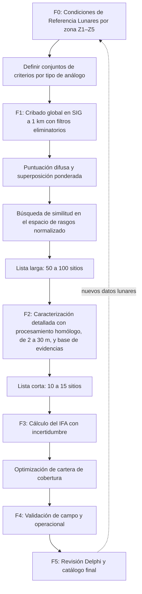

# Plan para identificar y analizar análogos terrestres de las bases permanentes del polo sur lunar

**Ámbito:** geografía planetaria comparada · habitabilidad · exploración humana
**Versión:** 1.0 (plan metodológico)
**Horizonte propuesto:** 24 meses

> [!IMPORTANT]
> **Hipótesis de trabajo:** ningún lugar de la Tierra reproduce a la vez el vacío, la gravedad de 0,165 g, la radiación cósmica sin atenuar y las temperaturas criogénicas de las trampas frías del polo sur lunar. Por eso el plan no busca *un* análogo, sino una **cartera de análogos parciales**. Cada uno se escoge por su fidelidad en unas dimensiones y zonas funcionales concretas. Las brechas que ningún lugar terrestre cubre se asignan explícitamente a instalaciones de laboratorio.

---

## 0. Resumen ejecutivo

El plan tiene seis fases:

1. Definir las **Condiciones de Referencia Lunares (CRL)** para cada zona funcional de una base del polo sur: crestas iluminadas, mesetas de alunizaje, laderas de transición, regiones permanentemente sombreadas (PSR) y subsuelo.
2. Hacer un **cribado global con SIG** usando criterios eliminatorios y puntuables en ocho dimensiones más tres dimensiones transversales.
3. Caracterizar en detalle una lista corta de sitios con **procesamiento homólogo**: los mismos algoritmos, resoluciones y proyecciones para los datos lunares y terrestres.
4. Calcular un **Índice de Fidelidad Analógica (IFA)** por parámetro, dimensión, zona y objetivo de misión, con propagación de incertidumbre y análisis de sensibilidad.
5. Optimizar una **cartera mínima de análogos** que cubra todas las combinaciones de dimensión y zona.
6. **Validar** con campañas de campo, pruebas de inferencia "de la órbita al suelo", simulaciones operacionales y un panel Delphi de expertos.

---

## 1. Objetivos, alcance y definiciones

### 1.1 Objetivos

| # | Objetivo | Resultado verificable |
|---|---|---|
| O-1 | Caracterizar cuantitativamente las condiciones esperadas en las zonas candidatas a base permanente del polo sur lunar | Tabla CRL con rangos e incertidumbres por zona |
| O-2 | Identificar sitios terrestres análogos de forma sistemática y reproducible | Catálogo georreferenciado (lista larga ≈ 50–100 sitios; lista corta ≈ 10–15) |
| O-3 | Comparar la Tierra y la Luna dimensión por dimensión con métricas explícitas | Matriz IFA con intervalos de confianza |
| O-4 | Traducir similitudes y diferencias en implicaciones de diseño | Recomendaciones para refugio, ISRU, operaciones, energía y factores humanos |
| O-5 | Validar las conclusiones | Informe de validación (campo, operaciones y expertos) |

### 1.2 Tipología de análogos

- **Análogo de propiedad:** reproduce un valor físico, por ejemplo la temperatura, la mineralogía o la pendiente.
- **Análogo de proceso:** reproduce un mecanismo, aunque su magnitud sea distinta. Ejemplos: atrapamiento frío controlado por la topografía, sublimación de hielo bajo una capa seca o formación de cráteres de impacto.
- **Análogo operacional:** reproduce restricciones de misión como aislamiento, logística, oscuridad, latencia de comunicaciones o EVA con equipo pesado.

Cada sitio se evalúa por separado en las tres categorías. Un lugar puede ser un análogo operacional excelente y un análogo de propiedad mediocre.

### 1.3 Zonificación funcional de una base en el polo sur lunar

La base no es un punto, sino un sistema de zonas con funciones y ambientes diferentes. Toda comparación se hace **por zona**.

| Zona | Descripción | Función en la base | Ejemplos lunares (regiones candidatas de Artemis III y otros) |
|---|---|---|---|
| **Z1** Crestas y bordes iluminados | Puntos con iluminación casi continua, a veces llamados "picos de luz eterna" | Hábitat, energía solar, comunicaciones | Cresta de conexión Shackleton–de Gerlache, Macizo Malapert, Nobile Rim 1/2, de Gerlache Rim 2, Pico cerca de Cabeus B |
| **Z2** Mesetas y llanuras | Superficies de baja pendiente | Alunizaje, almacenamiento, infraestructura | Meseta de Mons Mouton, Slater Plain |
| **Z3** Laderas de transición | Sombras intermitentes y gradientes térmicos fuertes | Rutas de tránsito y logística entre Z1 y Z4 | Flancos interiores de Shackleton, Haworth y de Gerlache |
| **Z4** Regiones permanentemente sombreadas (PSR) y trampas frías | Sin luz solar directa, T < 110 K | Extracción de hielo (ISRU) y ciencia de volátiles | Cabeus, Haworth, Shoemaker, Faustini, interior de Shackleton |
| **Z5** Subsuelo y refugios | Regolito profundo, posibles cavidades | Blindaje contra radiación y estabilidad térmica | Bermas de regolito, hábitats enterrados |

Las regiones candidatas citadas son las nueve anunciadas por la NASA en 2024. El plan añade las zonas objetivo del programa ILRS (China–Rusia) y de Chang'e-7. La lista se actualizará en la fase F0.

---

## 2. Condiciones de Referencia Lunares (CRL)

Los valores son órdenes de magnitud basados en la literatura. Se refinarán en la fase F0 con datos de LRO, Chandrayaan, KPLO/ShadowCam y Chang'e, y con modelos propios para cada sitio candidato.

| Dimensión | Parámetro | Valor de referencia lunar (aprox.) | Zonas | Fuente principal |
|---|---|---|---|---|
| Gravedad | g | 1,62 m s⁻² (0,165 g) | Todas | Constante |
| Topografía | Relieve regional | Hasta ~8–9 km en cientos de km. Shackleton: Ø ≈ 21 km, profundidad ≈ 4 km, d/D ≈ 0,2 | Z1–Z4 | LOLA, NAC DTM |
| | Pendientes | Interior de Shackleton ~30–35°. Requisito de alunizaje del orden de < 8–10° (confirmar con los requisitos HLS vigentes) | Z2, Z3 | LOLA |
| Geología | Litología | Tierras altas anortosíticas (plagioclasa cálcica, An > 90) sobre el borde de la cuenca Polo Sur–Aitken (SPA), más máfica | Todas | Clementine, LP-GRS, Kaguya, muestras de Chang'e-6 (SPA) |
| | Regolito | Tamaño medio de grano ~60–80 µm. Granos angulosos con aglutinados vítreos. Densidad 1,3–1,9 g cm⁻³. Cohesión 0,1–1 kPa. Ángulo de fricción 30–50°. Conductividad térmica ~10⁻³ W m⁻¹ K⁻¹ en la superficie | Todas | Lunar Sourcebook, Apollo |
| | Actividad | Sismos lunares someros de hasta M ≈ 5 (Apollo). Escarpes lobulados y deslizamientos cerca del polo sur. Impactos de micrometeoritos | Todas | Apollo PSE, Watters et al. 2024 |
| Agua | Hielo | Hielo mezclado con regolito en trampas frías. LCROSS (Cabeus): 5,6 ± 2,9 % en peso de H₂O en la pluma. Hielo superficial expuesto en algunas PSR (M³). Hidrógeno equivalente a agua ~0,1–1,5 % en peso a escala de decenas de km (neutrones). Otros volátiles: CO, H₂S, NH₃, SO₂, CH₄, CH₃OH | Z4 (Z3 en el subsuelo) | LCROSS, LEND, LPNS, M³, LAMP, Mini-RF |
| | Agua líquida | Ausente | — | — |
| Radiación | Rayos cósmicos galácticos (GCR) en la superficie | ~1369 µSv día⁻¹ (~57 µSv h⁻¹; Chang'e-4, mínimo solar) | Z1–Z4 | Zhang et al. 2020; CRaTER |
| | Eventos de partículas solares (SPE) | Dosis de cientos de mSv a > 1 Sv en horas o días sin blindaje (eventos extremos) | Z1–Z4 | Modelos de eventos de 1972 y 1989 |
| | UV y escudos | Espectro solar completo, incluido UV-C. Sin magnetosfera propia ni atmósfera | Z1–Z3 | — |
| Temperatura | PSR | ~25–110 K. Mínimos medidos de ~25–40 K | Z4 | Diviner (Paige et al. 2010) |
| | Crestas iluminadas | ~150–260 K según pendiente y orientación. Valores típicos de ~200–230 K. Pueden bajar de ~100–130 K durante eclipses topográficos de varios días | Z1 | Diviner, modelos |
| | Subsuelo | Casi constante (media anual) por debajo de ~0,3–1 m | Z5 | Modelos 1D |
| Atmósfera | Presión superficial | ~3 × 10⁻¹⁰ Pa (exosfera de He, Ar y Ne) | Todas | LADEE, Apollo |
| Iluminación | Elevación solar | ≤ ~1,5° sobre el horizonte geométrico. La oblicuidad es 1,54° | Todas | Efemérides |
| | Fracción iluminada | Mejores puntos: ~80–90 % a ras de suelo y > 90 % con mástiles de ≥ 10 m. Oscuridad continua máxima de ~días | Z1 | Mazarico et al. 2011; Gläser et al. 2014 |
| | Ciclo | Mes sinódico de 29,53 días. Ciclo nodal de 18,6 años. Contraste extremo sin luz difusa del cielo | Todas | — |
| | Visibilidad de la Tierra | Intermitente. Depende de la libración y del horizonte local | Z1–Z3 | LOLA y efemérides |
| Peligros | Polvo | Carga electrostática, partículas abrasivas y adhesivas. Eyecciones por los motores de los alunizadores | Todas | Apollo, modelos CFD-DSMC |
| | Otros | Micrometeoritos, SPE, ciclos térmicos, carga eléctrica en las PSR, oscuridad y navegación, aislamiento | Todas | — |

---

## 3. Criterios de selección

Cada criterio se clasifica en dos tipos:

- **[E] Eliminatorio:** se aplica en el cribado según el tipo de análogo buscado. Un desierto polar, por ejemplo, no se evalúa con los mismos filtros que una cueva.
- **[P] Puntuable:** contribuye al IFA (sección 5).

### 3.1 Topografía

| Criterio | Tipo | Umbral o métrica | Justificación lunar |
|---|---|---|---|
| Cráteres de impacto (confirmados) o depresiones con geometría de cuenco | [P] (eliminatorio para análogos de cráter) | Relación profundidad/diámetro (d/D), estado de conservación, diámetro normalizado por la transición simple–complejo (D/Dₜ) | Shackleton y Haworth son cráteres. La morfología escala con g: Dₜ ≈ 15–20 km en la Luna frente a ≈ 2–4 km (sedimentario) y ≈ 4–6 km (cristalino) en la Tierra |
| Crestas y cumbres con horizonte despejado | [P] | Elevación relativa (TPI), índice de visibilidad del cielo (SVF), perfil de horizonte | Análogo geométrico de los puntos de Z1 |
| Mesetas de baja pendiente | [P] | % de área con pendiente < 8° y < 15° a líneas base de 5, 20 y 100 m | Zonas de alunizaje Z2 |
| Laderas pronunciadas y rugosidad | [P] | Distribución de pendientes, rugosidad RMS, densidad de bloques ≥ 1 m por km² | Movilidad en Z3 y acceso a Z4 |
| Distancia entre zona iluminada y zona sombreada | [P] | Distancia y coste de traversa (ruta de menor coste) entre crestas y depresiones frías | Acceso energía–recurso de Z1 a Z4 |

### 3.2 Geología

| Criterio | Tipo | Umbral o métrica |
|---|---|---|
| Litología anortosítica o cristalina ígnea, o máfica en el caso de la SPA | [P] | Distancia de Aitchison en el espacio de óxidos mayores (SiO₂, Al₂O₃, CaO, FeO, MgO, TiO₂, Na₂O). Contenido de plagioclasa |
| Material no consolidado tipo regolito, con granos angulosos y frescos (ceniza, tefra, harina glaciar, brechas de impacto) | [P] | Granulometría (D₁₀, D₅₀, fracción < 20 µm), angulosidad, densidad aparente, cohesión, ángulo de fricción |
| Productos de impacto (brechas, fundidos, vidrio) | [P] | Presencia y abundancia |
| Baja meteorización química y poca materia orgánica | [P] | Índice químico de alteración (CIA), carbono orgánico total. Cuanto menor, más lunar |
| Actividad geológica | [P] | Sismicidad (aceleraciones con periodo de retorno de 475 años), volcanismo activo a < 100 km, procesos de ladera. Se registra como "más severa", "comparable" o "más benigna" que en la Luna |

### 3.3 Recursos hídricos

| Criterio | Tipo | Umbral o métrica |
|---|---|---|
| Hielo en el suelo (permafrost cementado por hielo, hielo glaciar enterrado o hielo atrapado en cavidades) | [E] para análogos de Z4 | Presencia confirmada |
| Capa seca sobre el hielo (análoga a la capa desecada sobre el hielo en las PSR) | [P] | Profundidad de la tabla de hielo (cm) y su variabilidad espacial |
| Contenido de hielo | [P] | % en peso y % en volumen. Rango lunar de interés: 0,1 a > 10 % en peso |
| Estado de equilibrio del hielo | [P] | Hielo en equilibrio de difusión de vapor frente a hielo relicto. Edad |
| Ausencia o escasez de agua líquida | [P] | Precipitación < 100 mm año⁻¹, humedad relativa media, presencia de salmueras. Menos agua líquida implica mayor fidelidad |
| Accesibilidad | [P] | Distancia a infraestructura, pendientes, resistencia a la compresión del suelo helado |

### 3.4 Radiación

| Criterio | Tipo | Umbral o métrica |
|---|---|---|
| Baja rigidez de corte geomagnético | [P] | Rc < 1 GV (latitudes geomagnéticas altas). La dosis cósmica aumenta |
| Baja masa atmosférica por encima | [P] | Columna atmosférica en g cm⁻² (nivel del mar ≈ 1033; a 600 hPa ≈ 610) |
| UV elevado y ozono bajo | [P] | Índice UV máximo y climatología de UV-B. Agujero de ozono antártico |
| Escudos naturales: cavidades, cuevas, tubos de lava | [P] | Espesor del techo de roca (m y g cm⁻²) y fracción de cielo visible |

> [!NOTE]
> Ningún sitio terrestre reproduce las dosis de GCR o SPE en la superficie lunar: la brecha es de 2–3 órdenes de magnitud. Este criterio sirve para escoger análogos de **concepto de blindaje** (cuevas, bermas, topografía) y de **degradación de materiales por UV**, no para reproducir dosis.

### 3.5 Temperaturas extremas

| Criterio | Tipo | Umbral o métrica |
|---|---|---|
| Temperatura media anual del aire | [E] para análogos fríos | < −10 °C |
| Temperatura mínima absoluta de la superficie | [P] | Lo más baja posible. Referencia terrestre natural: ≈ −98 °C (175 K) en depresiones de la meseta antártica oriental |
| Amplitud diaria y estacional | [P] | ΔT diaria y anual de la superficie y del suelo a 10 cm |
| Gradientes espaciales controlados por topografía o sombra | [P] | ΔT entre sol y sombra a distancias < 1 km. Bolsas de aire frío |
| Inercia térmica del sustrato | [P] | Inercia térmica en J m⁻² K⁻¹ s⁻½. Lunar ≈ 50; los suelos secos terrestres suelen ser ~10–30 veces mayores |

### 3.6 Atmósfera

| Criterio | Tipo | Umbral o métrica |
|---|---|---|
| Presión baja | [P] | Presión media en hPa. La mínima en sitios accesibles es ≈ 530–680 hPa (meseta antártica, Altiplano, Mauna Kea) |
| Aridez y presión parcial de vapor baja | [P] | Presión de vapor (Pa) y punto de escarcha. Controla la sublimación del hielo |
| Viento bajo o moderado | [P] | Velocidad media y percentil 99. En la Luna no hay viento, así que menos viento implica mayor fidelidad |
| Cielo despejado | [P] | Fracción de nubosidad. Condiciona la iluminación directa y el enfriamiento radiativo |

### 3.7 Iluminación

| Criterio | Tipo | Umbral o métrica |
|---|---|---|
| Latitud alta (sol rasante y azimut que gira 360°) | [E] para análogos de iluminación | \|φ\| > 66,5° |
| Elevación solar cercana a 0–2° con giro azimutal completo | [P] | Días al año con elevación máxima ≤ 2° y rotación completa. Óptimo en el polo geográfico: unos 7–8 días por equinoccio |
| Ganancia de iluminación por elevación (análogo de los "picos de luz eterna") | [P] | Diferencia de horas de sol entre una cumbre y su entorno, calculada con modelos de horizonte |
| Sombra persistente controlada por la topografía | [P] | Fracción del año sin sol directo (circos, grietas, cuevas, fondos de valle) |
| Contraste lumínico | [P] | Cociente de luminancia entre superficie soleada y sombreada, y albedo del sustrato. La nieve (0,8–0,9) es poco lunar; las rocas oscuras (0,1–0,3) se parecen más |

### 3.8 Peligros ambientales

| Criterio | Tipo | Métrica |
|---|---|---|
| Polvo abrasivo y adhesivo | [P] | Fracción < 20 µm, angulosidad, dureza. Frecuencia de eventos de polvo |
| Fenómenos sin equivalente lunar (viento catabático, ventisca, lluvia, rayos) | [P] (penalizan la fidelidad, pero ayudan al análisis de robustez) | Frecuencia y periodo de retorno |
| Volcanismo y sismicidad | [P] | Distancia a volcanes activos (Smithsonian GVP) y PGA |
| Inestabilidad de laderas | [P] | Inventarios de deslizamientos y desprendimientos |
| Aislamiento y oscuridad prolongada | [P] | Días sin evacuación posible y duración de la noche polar |

### 3.9 Dimensiones transversales

- **Gravedad.** Es invariante y no tiene análogo. Se compensa con escalado terramecánico, vehículos de masa reducida, vuelos parabólicos y simulaciones de elementos discretos (DEM).
- **Comunicaciones.** Por encima de ~81° de latitud, los satélites geoestacionarios quedan bajo el horizonte. Es un buen análogo de la visibilidad intermitente de la Tierra desde el polo sur lunar.
- **Logística, regulación y ética.** Incluye la accesibilidad, las ventanas estacionales y los permisos. En la Antártida rigen el Tratado Antártico, el Protocolo de Madrid (evaluación de impacto ambiental), las ASPA y las ASMA; por ejemplo, la ASMA n.º 2 de los Valles Secos de McMurdo. En otros sitios hace falta el consentimiento de los pueblos indígenas, como los inuit en Nunavut o la Nación Innu en Labrador, y deben respetarse las figuras de protección UNESCO.

---

## 4. Metodología de identificación

### 4.1 Principios metodológicos

1. **Procesamiento homólogo.** Las métricas terrestres y lunares se calculan con los mismos algoritmos, líneas base, resoluciones y proyecciones. Por ejemplo, la estereográfica polar EPSG:3031 para la Antártida y su equivalente lunar IAU para el polo sur. Así la diferencia entre números refleja una diferencia ambiental y no metodológica.
2. **Normalización por escala física.** Las morfologías dependientes de g se comparan con magnitudes adimensionales, como D/Dₜ o la pendiente relativa al ángulo de reposo. Los procesos térmicos se comparan mediante balances de energía, no solo por la temperatura.
3. **Comparación por zona funcional** (Z1–Z5), nunca por la "Luna" en conjunto.
4. **Escenarios para lo que aún no se sabe.** La distribución del hielo en las PSR se trata con tres escenarios:
   - S1: disperso, 0,1–1 % en peso.
   - S2: hielo intersticial, 1–5 % en peso.
   - S3: rico en hielo, > 10 % en peso o en capas.
5. **Trazabilidad FAIR.** Todos los datos y el código se versionan y se describen con metadatos STAC.

### 4.2 Fuentes de datos lunares

| Fuente | Producto | Uso en el plan |
|---|---|---|
| LRO **LOLA** | Modelos de elevación (DEM) polares de 5–20 m/px; pendientes, rugosidad, albedo a 1064 nm | Topografía, horizontes, iluminación |
| LRO **LROC** NAC/WAC | Imágenes de 0,5–1,5 m/px y DTM estéreo | Bloques, cráteres pequeños, peligros |
| KPLO **ShadowCam** | Imágenes del interior de las PSR (~1,7 m/px) | Topografía y morfología de Z4 |
| LRO **Diviner** | Temperaturas superficiales y mapas de estabilidad del hielo | Temperatura y trampas frías |
| LRO **LAMP** | Albedo en Lyman-α y UV lejano de las PSR | Escarcha y porosidad |
| LRO **LEND**, Lunar Prospector **NS** | Flujo de neutrones epitérmicos (hidrógeno) | Agua en el subsuelo (~1 m) |
| Chandrayaan-1 **M³** | Espectros IR | Hielo superficial expuesto |
| LRO **Mini-RF**, Chandrayaan-2 **DFSAR** | Radar (CPR y polarimetría) | Hielo o rugosidad en el subsuelo (ambiguo) |
| Chandrayaan-2 **OHRC/IIRS** | Imagen de 0,25 m/px e IR | Peligros a escala métrica |
| SELENE/Kaguya | TC, LALT, MI, GRS | Topografía y composición |
| **LCROSS** | Espectros de la pluma de impacto | Concentración de H₂O y volátiles |
| LRO **CRaTER**, Chang'e-4 **LND** | Dosis y espectro LET | Radiación |
| Chandrayaan-3 (ChaSTE, ILSA), IM-2 (operación limitada) | Perfiles térmicos y sismicidad a ~69°S; datos cerca de Mons Mouton | Verificación in situ a latitudes altas |
| Muestras Apollo y Chang'e-5/6 | Geoquímica y geotecnia (incluida la SPA en Chang'e-6) | Geología y regolito |
| Datos futuros (CLPS, Chang'e-7, Artemis) | Datos in situ polares | Validación prospectiva (sección 8) |

### 4.3 Fuentes de datos terrestres

| Dimensión | Bases de datos y sensores |
|---|---|
| Topografía | Copernicus DEM GLO-30, **REMA** (Antártida, 2 m), **ArcticDEM** (2 m), TanDEM-X (12 m), LiDAR nacionales (USGS 3DEP, IGN), fotogrametría con dron y escáner láser terrestre (TLS) en campo |
| Imágenes | WorldView-3 (0,31 m), Pléiades Neo (0,3 m), Sentinel-2, Landsat 8/9, ASTER (TIR multiespectral para silicatos), EnMAP/PRISMA/EMIT (hiperespectral), Sentinel-1 y ALOS-2 (SAR, InSAR) |
| Geología | Mapa litológico global **GLiM**, OneGeology, GeoMAP (Antártida), servicios geológicos nacionales, GEOROC/EarthChem, **Earth Impact Database** (PASSC) y Smithsonian **GVP** |
| Agua y hielo | ESA CCI Permafrost, mapas globales de permafrost, BedMachine, perforaciones GTN-P, campañas de georradar (GPR) publicadas |
| Temperatura | MODIS/VIIRS LST, Landsat TIRS, ERA5/ERA5-Land, redes de estaciones meteorológicas automáticas (AMRC, McMurdo LTER, Domo C, Domo A), perforaciones térmicas |
| Atmósfera | ERA5, radiosondeos IGRA, estaciones locales |
| Radiación | Monitores de neutrones (**NMDB**: Polo Sur, McMurdo, Domo C, entre otros), modelos CARI-7 y EXPACS/PARMA, mapas de rigidez de corte (IGRF), climatologías UV (TEMIS, OMI/TROPOMI) |
| Iluminación | Calculada con DEM y efemérides (SPICE, Skyfield, pvlib), corregida por refracción. Nubosidad de MODIS |
| Peligros | Viento (ERA5, estaciones), aerosoles (MERRA-2, CALIPSO), sismicidad (USGS ComCat, ISC), volcanes (GVP), inventarios de deslizamientos |
| Logística | Catálogo de estaciones de COMNAP, accesos y permisos |

**Plataformas:** Google Earth Engine para el cribado global. Python (GDAL, rasterio, xarray, scikit-learn) y QGIS para el análisis. ISIS3 y Ames Stereo Pipeline para los datos lunares. Datos lunares desde el PDS (Geosciences Node), USGS Astrogeology y LROC QuickMap.

### 4.4 Estudios científicos y catálogos de análogos

- Revisión sistemática con protocolo tipo PRISMA en Web of Science, Scopus y ADS.
  - Términos de búsqueda: *"lunar analog"*, *"planetary analogue"*, *"cold trap"*, *"ice-cemented permafrost"*, *"Dry Valleys"*, *"impact crater anorthosite"*, *"lava tube ice"* y sus equivalentes en español.
- Programas y catálogos existentes:
  - NASA: Desert RATS, PISCES (pruebas ISRU en Mauna Kea), HMP en Haughton, NEEMO, HERA.
  - ESA: PANGAEA y CAVES (Lanzarote), Concordia como análogo de aislamiento.
  - Agencia Espacial Canadiense: programa de análogos.
  - Europlanet: análogos de campo.
  - Revisiones de síntesis, como Preston & Dartnell (2014).
- Extracción de datos: cada estudio se codifica según el sitio, las dimensiones medidas, los valores, los métodos y la incertidumbre. Con ello se construye una **base de evidencias** que complementa la teledetección.

### 4.5 Simulaciones y modelos

| Modelo | Aplicación lunar | Aplicación terrestre (homóloga) |
|---|---|---|
| Trazado de rayos y horizontes sobre el DEM | Fracción iluminada, oscuridad máxima, visibilidad de la Tierra | El mismo código sobre REMA o ArcticDEM, con refracción y nubosidad |
| Modelo termofísico 1D más intercambio radiativo 3D en cráteres (tipo Ingersoll et al. 1992 y Hayne et al. 2017) | Temperaturas de las PSR y de las crestas | Balance energético de superficie (por ejemplo, CryoGrid) para comparar término a término los flujos radiativos, convectivos y conductivos |
| Estabilidad del hielo por difusión de vapor (Schorghofer y colaboradores) | Profundidad de la tabla de hielo en las PSR | La misma física aplicada al permafrost cementado de los Valles Secos (University Valley, Beacon Valley) |
| Transporte de radiación: HZETRN/OLTARIS, Geant4, PHITS; modelo GCR Badhwar–O'Neill; espectros SPE de referencia | Dosis en hábitats con bermas y en cráteres con fracción de cielo reducida | CARI-7 y EXPACS para la dosis cósmica en los sitios terrestres |
| DEM granular y terramecánica (Bekker–Wong) | Excavación y tráfico a 1/6 g | Escalado de los ensayos de campo con vehículos de masa reducida |
| CFD-DSMC de la interacción entre penacho y superficie | Eyección de regolito por los motores | Ensayos con chorros sobre tefra o ceniza |
| Análisis multicriterio en SIG | — | Cribado global (sección 4.6) |

### 4.6 Flujo de trabajo de identificación

**Detalle del cribado (F1):**

1. **Rasterización global** a ~1 km de una pila de capas: temperatura media y mínima, precipitación, humedad, permafrost, litología (GLiM), distancia a cráteres de impacto confirmados, altitud y presión, rigidez de corte, índice UV, latitud, viento, nubosidad y accesibilidad.
2. **Filtros eliminatorios** según el tipo de análogo:
   - "Desierto polar frío": temperatura media anual < −10 °C, precipitación < 250 mm, permafrost presente.
   - "Cráter cristalino": cráter confirmado y basamento ígneo o metamórfico.
3. **Funciones de pertenencia difusa** (de 0 a 1) para cada criterio puntuable. La forma de cada función (umbral, rampa o campana) se justifica con las CRL.
4. **Búsqueda de similitud**: distancia de Gower entre el vector de rasgos de cada píxel o polígono y el vector CRL de cada zona. Se acompaña de un agrupamiento no supervisado para descubrir tipologías no previstas.
5. **Lista larga**, revisada manualmente y contrastada con la base de evidencias.

### 4.7 Optimización de la cartera de análogos

Sea $x_s \in \{0,1\}$ la decisión de incluir el sitio $s$, $F_{s,k,z}$ su fidelidad en la dimensión $k$ y la zona $z$, y $c_s$ su coste logístico. Se resuelve:

$$
\min_{x} \sum_s c_s\, x_s \quad \text{sujeto a} \quad \max_{s} \left( x_s\, F_{s,k,z} \right) \geq F^{*}_{k,z} \;\; \forall (k,z) \in \mathcal{C}
$$

Aquí $\mathcal{C}$ es el conjunto de combinaciones dimensión × zona que sí pueden cubrirse en la Tierra, y $F^{*}$ es la fidelidad mínima exigida (por ejemplo, 0,5). Las combinaciones que quedan fuera de $\mathcal{C}$ se asignan a laboratorio (sección 7). El resultado es la cartera más pequeña y barata que cubre todo lo cubrible.

---

## 5. Análisis comparativo

### 5.1 Marco cuantitativo

**a) Similitud por parámetro** $S_j \in [0,1]$. Su forma depende del tipo de parámetro.

- *Parámetros lineales* (temperatura, pendiente). Con el intervalo lunar $[a_j, b_j]$ y el valor terrestre $x_j$:

$$
d_j = \begin{cases} 0 & a_j \le x_j \le b_j \\ \min(|x_j-a_j|,\,|x_j-b_j|) & \text{en otro caso} \end{cases} \qquad S_j = \max\!\left(0,\; 1-\frac{d_j}{\delta_j}\right)
$$

  La tolerancia $\delta_j$ se fija según su relevancia de ingeniería. Por ejemplo, 50 K para la temperatura o 5° para la pendiente de alunizaje.

- *Parámetros que abarcan órdenes de magnitud* (presión, dosis, contenido de hielo). Se usa la misma fórmula sobre $\log_{10}$, con $\delta_j$ expresado en órdenes de magnitud.
- *Distribuciones* (pendientes, series temporales de temperatura, distribución de tamaños de cráteres, granulometría). Se usa la distancia de Wasserstein $W_1$ entre las distribuciones terrestre y lunar: $S_j = 1-\min(1, W_1/\delta_j)$. La prueba de Kolmogórov–Smirnov se reporta como complemento.
- *Composición* (óxidos mayores, mineralogía modal). Se usa la distancia de Aitchison tras la transformación log-cociente centrada (clr), que respeta la naturaleza composicional de los datos: $S_j = \max(0, 1-d_A/\delta_j)$.

**b) Brecha con signo** $G_j$. Indica la magnitud y la dirección de la diferencia: si la Tierra es "más benigna" o "más severa". Se expresa en unidades físicas (K, órdenes de magnitud, grados). Se reporta siempre junto a $S_j$, porque dos análogos con la misma similitud pueden fallar en direcciones opuestas.

**c) Fidelidad por dimensión, zona y objetivo**

$$
F_{k,z} = \frac{\sum_j w_{jk}\, S_j}{\sum_j w_{jk}}, \qquad F_{\text{obj},z} = \sum_k \omega_{k,\text{obj}}\, F_{k,z}
$$

**d) Clases de fidelidad**

| Clase | Valor de F | Significado |
|---|---|---|
| Alta | ≥ 0,75 | Apto para ensayos de propiedad o proceso |
| Media | 0,50–0,75 | Apto con correcciones o escalado |
| Baja | 0,25–0,50 | Solo útil como análogo operacional o de proceso |
| No análoga | < 0,25 | Requiere laboratorio |

**e) Ponderación.** Los pesos $\omega$ se obtienen con un proceso analítico jerárquico (AHP), con razón de consistencia < 0,1, a partir de juicios de expertos recogidos en el Delphi. Propuesta inicial, que se refinará:

| Dimensión | Refugio y hábitat | Extracción de recursos (ISRU) | Operaciones y EVA | Energía y comunicaciones | Ciencia |
|---|---|---|---|---|---|
| Topografía | 0,15 | 0,15 | 0,25 | 0,20 | 0,10 |
| Geología | 0,15 | 0,20 | 0,15 | 0,05 | 0,25 |
| Recursos hídricos | 0,05 | 0,35 | 0,05 | 0,00 | 0,25 |
| Radiación | 0,25 | 0,05 | 0,10 | 0,05 | 0,05 |
| Temperatura | 0,15 | 0,15 | 0,15 | 0,15 | 0,10 |
| Atmósfera | 0,10 | 0,05 | 0,10 | 0,05 | 0,05 |
| Iluminación | 0,05 | 0,05 | 0,10 | 0,45 | 0,05 |
| Peligros | 0,10 | 0,00 | 0,10 | 0,05 | 0,15 |
| **Suma** | **1,00** | **1,00** | **1,00** | **1,00** | **1,00** |

**f) Incertidumbre y sensibilidad**

- Simulación de Monte Carlo con $N = 10^4$ realizaciones:
  - Los valores lunares se muestrean de sus distribuciones; por ejemplo, el hielo con una distribución log-normal por escenario S1–S3.
  - Los valores terrestres se muestrean según su error de medida.
  - Los pesos se muestrean de una distribución de Dirichlet centrada en los pesos AHP.
- Para cada sitio se reportan la mediana, el intervalo de confianza del 90 % y la **estabilidad del ranking**, es decir, la probabilidad de que el sitio esté entre los 3 primeros.
- Análisis de sensibilidad global con índices de Sobol, para saber qué parámetros dominan la incertidumbre del IFA.

### 5.2 Comparación dimensión por dimensión

#### 5.2.1 Topografía

| Aspectos | Métricas | Cuantificación | Relevancia para la base |
|---|---|---|---|
| Morfología de cráteres | d/D, D/Dₜ, pendiente de las paredes, altura del borde, perfil radial | $S$ lineal con d/D. Wasserstein para los perfiles normalizados | Análogos de acceso a las PSR y de estabilidad de las paredes |
| Distribución de pendientes y rugosidad | Histogramas de pendiente a líneas base de 5, 20 y 100 m; rugosidad RMS; índice de rugosidad del terreno (TRI) | Wasserstein entre histogramas; % de área transitable | Seguridad del alunizaje (Z2), traversas (Z3), diseño de rovers |
| Peligros de pequeña escala | Densidad de bloques ≥ 1 m, distribución de cráteres pequeños | Brecha en log₁₀ de la densidad | Evaluación de riesgo de alunizaje y EVA |
| Geometría de horizonte | Perfil de horizonte a 360°, factor de visibilidad del cielo | Error cuadrático medio entre perfiles normalizados | Controla la iluminación y el blindaje topográfico (la dosis GCR baja con el SVF) |
| Conectividad funcional | Coste de la ruta de menor coste entre Z1 y Z4 (modelo energía–pendiente), tiempo de tránsito en sombra | Cociente Tierra/Luna | Logística de ISRU y tendidos de energía |

> [!TIP]
> Una vez normalizado por Dₜ, un cráter terrestre simple y fresco de ~3–4 km en roca cristalina, como **Pingualuit** (Nunavik, Ø 3,4 km), es morfológicamente más comparable a Shackleton (~21 km) que un cráter terrestre de 20 km, que en la Tierra sería complejo y estaría erosionado. Con la fórmula $S$ de distribuciones, sobre perfiles adimensionales, esto se puede cuantificar.

#### 5.2.2 Geología

| Aspectos | Métricas | Cuantificación | Relevancia para la base |
|---|---|---|---|
| Composición química y mineral | Óxidos mayores (XRF), mineralogía modal (XRD), contenido de An en la plagioclasa | Distancia de Aitchison; brecha en FeO y TiO₂ (afecta a la extracción de oxígeno) | Procesos ISRU: electrólisis de óxidos fundidos, reducción carbotérmica, fabricación aditiva |
| Propiedades del regolito | D₅₀, fracción < 20 µm, angulosidad (factor de forma), densidad, porosidad, cohesión, ángulo de fricción, índice de cono | Wasserstein para la granulometría; $S$ lineal para la geotecnia | Excavación, cimentaciones, bermas de blindaje, mitigación de polvo |
| Propiedades térmicas y eléctricas | Conductividad, inercia térmica, resistividad, constante dieléctrica | Brecha en log₁₀. En vacío la conductividad del regolito cae ~2 órdenes respecto a suelos con aire en los poros | Diseño térmico de hábitats y almacenamiento enterrado (Z5) |
| Meteorización y biología | CIA, carbono orgánico total, minerales hidratados | Penalización de fidelidad | En la Tierra contaminan las señales de volátiles; en la Luna no existen |
| Actividad geológica | Sismicidad (PGA, duración de las señales), escarpes y fallas activas, frecuencia de desprendimientos | Brecha con signo (más severa o más benigna) | Diseño sísmico. Los sismos lunares someros tienen coda larga por la baja atenuación. Hay que evitar ubicar el hábitat cerca de escarpes activos |

#### 5.2.3 Recursos hídricos

| Aspectos | Métricas | Cuantificación | Relevancia para la base |
|---|---|---|---|
| Forma del hielo | Intersticial, masivo, en capas, escarcha superficial | Concordancia categórica con el escenario S1–S3 | Diseño del método de extracción: calentamiento in situ, excavación con horno, perforación |
| Contenido de hielo | % en peso y % en volumen | $S$ sobre log₁₀ frente a cada escenario | Rendimiento de extracción (kg H₂O por m³) |
| Profundidad de la tabla de hielo y capa seca | cm, variabilidad espacial (semivariograma) | Wasserstein entre distribuciones; comparación con modelos de difusión homólogos | Prospección: perforación, georradar, neutrones |
| Resistencia del suelo helado | Resistencia a compresión simple a la temperatura de ensayo; extrapolación a 40–110 K | Brecha con signo (a T criogénica la resistencia sube mucho) | Energía de excavación y desgaste de herramientas |
| Química del hielo | Volátiles acompañantes, sales, isótopos (D/H) | Presencia o ausencia y similitud química | Pureza del agua y procesado. Ciencia de volátiles |
| Estabilidad durante la extracción | Tasa de sublimación al exponer el hielo | Cociente de tasas (en el vacío lunar, la pérdida es mucho mayor) | Pérdidas de producto y diseño de contención |
| Accesibilidad | Distancia y coste de traversa desde Z1, pendiente de acceso, operación en oscuridad | Cociente Tierra/Luna | Arquitectura de la base y número de viajes |

#### 5.2.4 Radiación

| Aspectos | Métricas | Cuantificación | Relevancia para la base |
|---|---|---|---|
| GCR | Dosis equivalente (µSv día⁻¹), espectro LET | Brecha en log₁₀. Luna ~1369 µSv día⁻¹ frente a ~1 µSv día⁻¹ (componente cósmica a nivel del mar) y pocos µSv día⁻¹ en mesetas polares altas | Blindaje del hábitat (~150 g cm⁻² por metro de regolito a 1,5 g cm⁻³) y límites de exposición |
| SPE | Fluencia > 10 MeV y > 100 MeV; dosis por evento | Sin análogo natural: categoría "No análoga" | Refugios de tormenta y procedimientos de alerta |
| UV | Irradiancia espectral, incluida UV-C | Brecha con signo; el Altiplano es el mejor análogo parcial | Degradación de polímeros, visores y paneles |
| Escudos naturales | Espesor y densidad del techo, SVF, atenuación medida | Atenuación relativa (adimensional), comparable entre ambos cuerpos con Geant4 | Uso de la topografía (paredes de cráter) y de bermas o cavidades |
| Neutrones secundarios | Flujo de neutrones de albedo | Diferencia de modelo | Dosis interior y técnica de prospección de hidrógeno |

#### 5.2.5 Temperatura

| Aspectos | Métricas | Cuantificación | Relevancia para la base |
|---|---|---|---|
| Rangos absolutos | Temperatura mínima, máxima y media de la superficie y a 10, 50 y 100 cm | $S$ lineal por zona. Las crestas Z1 (~200–230 K) se solapan con el invierno de la meseta antártica (~185–220 K). Las PSR (25–110 K) quedan 65–150 K por debajo del mínimo natural terrestre | Calificación de materiales, lubricantes, baterías y sellos |
| Ciclos | Amplitud diaria y estacional; periodo del ciclo (lunar 29,5 días, terrestre 24 h y 1 año) | Cociente de amplitudes; desfase de periodos | Fatiga térmica, almacenamiento de energía |
| Gradientes | ΔT entre sol y sombra por distancia (K m⁻¹); tasa de cambio (K h⁻¹) | Cociente | Paso de rovers y trajes entre luz y sombra (Z3) |
| Balance energético | Fracción de pérdida radiativa, convectiva y conductiva | Distancia euclidiana entre vectores de fracciones. En la Luna no hay convección | Una misma temperatura no implica el mismo entorno térmico: diseño del control térmico |
| Inercia térmica | J m⁻² K⁻¹ s⁻½ | Brecha en log₁₀ | Respuesta del sustrato y estabilidad del subsuelo (Z5) |

#### 5.2.6 Atmósfera

| Aspectos | Métricas | Cuantificación | Relevancia para la base |
|---|---|---|---|
| Presión y densidad | Pa; kg m⁻³ | Brecha en log₁₀ de unos 14–15 órdenes de magnitud: "No análoga" en todos los sitios | Integridad de hábitats y trajes, soldadura en frío, desgasificación. Hace falta cámara de vacío |
| Composición | Fracciones molares | Cualitativa | Contaminación química de las muestras de hielo en la Tierra |
| Vapor de agua | Presión parcial y punto de escarcha | Análogo de proceso: sublimación controlada por gradiente de vapor | Estabilidad del hielo expuesto o excavado |
| Viento y transporte eólico | Velocidad media y P99; flujo de sedimento | Penalización (en la Luna no hay viento) | El polvo terrestre se mueve por el viento y el lunar por penachos y carga eléctrica. Implica protocolos de polvo distintos |
| Columna como escudo | g cm⁻² | Entra en el cálculo de radiación (5.2.4) | Explica por qué la Tierra no reproduce la dosis |

#### 5.2.7 Iluminación

| Aspectos | Métricas | Cuantificación | Relevancia para la base |
|---|---|---|---|
| Geometría solar | Distribución de la elevación solar; velocidad azimutal (Luna ~0,5° h⁻¹; polo terrestre 15° h⁻¹) | Wasserstein sobre la elevación; factor de escala temporal ~29,5 | Orientación de paneles verticales con seguimiento azimutal |
| Disponibilidad de energía | % del tiempo iluminado (a ras de suelo y a 2, 10 y 20 m de altura); duración máxima de la oscuridad | $S$ lineal; brecha en horas o días | Dimensionado de baterías o pilas de combustible y altura de mástiles |
| "Picos de luz eterna" | Ganancia de iluminación de una cumbre frente a su entorno | Cociente de ganancias Tierra/Luna | Selección del emplazamiento energético (Z1) |
| Sombra persistente | Área y fracción del año sin sol directo | $S$ sobre fracción temporal | Análogos operacionales de trabajo en oscuridad (Z4) |
| Calidad de la luz | Contraste (luminancia sol/sombra), luz difusa del cielo, albedo | Brecha en log₁₀ del contraste | Percepción humana, visión artificial y navegación autónoma: hay que validar en instalaciones de iluminación |
| Comunicaciones | % de tiempo con línea de vista a la Tierra o a un relé | Cociente | Arquitectura de relés y antenas en mástil |

#### 5.2.8 Peligros ambientales

Se construye una **matriz de peligros** con probabilidad × consecuencia para cada sitio y para cada zona lunar. Cada peligro se clasifica en una de tres categorías:

- **Compartido**: abrasión por polvo, frío extremo, oscuridad prolongada, aislamiento, inestabilidad de laderas, sismicidad moderada.
- **Solo lunar**: vacío, SPE, micrometeoritos, carga electrostática en PSR y terminadores, eyección por penachos de motor.
- **Solo terrestre**: viento catabático, ventisca y *whiteout*, grietas glaciares, volcanismo activo (por ejemplo, el monte Erebus cerca de McMurdo), hipoxia de altitud, rayos, peligros biológicos.

| Métrica | Uso |
|---|---|
| Frecuencia y magnitud (periodo de retorno) por peligro compartido | $S$ sobre log₁₀ de la frecuencia |
| Fracción de peligros compartidos ponderada por consecuencia | Fidelidad de la dimensión |
| Peligros solo terrestres | Penalización de fidelidad, pero son útiles para probar la **robustez** de equipos y procedimientos |

**Relevancia:** permite saber qué procedimientos de seguridad pueden ensayarse en la Tierra y cuáles necesitan simulación o laboratorio.

### 5.3 Productos de síntesis

1. **Mapa de calor** de sitios × (dimensión, zona) con $F$ y su intervalo del 90 %.
2. **Diagramas de radar** por sitio, que superponen la fidelidad de propiedad, la de proceso y la operacional.
3. **Tabla de brechas irreducibles** (sección 7) con la instalación de laboratorio asignada.
4. **Fichas de sitio** de dos páginas: CRL frente a valores terrestres, $S_j$, $G_j$, recomendaciones de uso y restricciones regulatorias.

---

## 6. Ejemplos de entornos terrestres análogos

La matriz siguiente es una **hipótesis a priori**. Se cuantificará con el IFA en la fase F3.

| Entorno | Topografía | Geología | Agua | Radiación | Temperatura | Atmósfera | Iluminación | Peligros | Operacional | Zonas lunares |
|---|---|---|---|---|---|---|---|---|---|---|
| A. Desiertos polares fríos | Media | Baja–Media | **Alta** | Baja | Media | Baja (Media en sublimación) | Media–Alta | Media | Alta | Z3, Z4 |
| B. Meseta polar de gran altitud | Baja | Nula | Media | Baja–Media | **Alta (Z1)** | Baja | **Alta** | Media | **Alta** | Z1, Z4 (proceso) |
| C. Cráteres de impacto en roca cristalina o anortosítica | **Alta** | **Alta** | Media | Baja | Media–Baja | Baja | Media | Baja–Media | Media | Z1–Z4 (geomorfología) |
| D. Regiones volcánicas áridas | Media | Media | Baja | Baja | Baja | Baja | Baja | Media | **Alta** | Z2, Z5, EVA, ISRU |
| E. Mesetas altas y desiertos hiperáridos | Media | Baja–Media | Baja (Media en aridez) | Media (UV) | Baja–Media | **Media** (relativa) | Baja | Media | Media | Z1–Z2 (materiales) |
| F. Cuevas de hielo y tubos de lava con hielo | Media | Media | Media–Alta | **Alta** (concepto de blindaje) | Media | Baja | **Alta** (oscuridad) | Media | Alta | Z4, Z5 |

### A. Desiertos polares fríos: Valles Secos de McMurdo (Antártida) y desiertos árticos

- **Sitios representativos:** Beacon Valley, University Valley y valle de Wright (77–78°S, 0–2000 m de altitud).
- **Justificación por criterio:**
  - *Agua:* tienen **permafrost cementado por hielo bajo una capa de suelo seco** de centímetros a ~1 m de espesor, y hielo glaciar enterrado bajo till de sublimación en Beacon Valley, posiblemente de varios millones de años (edad debatida). Es el mejor análogo de proceso para hielo bajo capa desecada (escenarios S1–S2) y permite aplicar los mismos modelos de difusión de vapor que en las PSR.
  - *Atmósfera y temperatura:* temperatura media anual de −15 a −30 °C, humedad muy baja, sublimación dominante y precipitación < 100 mm año⁻¹.
  - *Iluminación:* día y noche polares, sol rasante en primavera y otoño.
  - *Geología:* tills de granito, dolerita y arenisca, con meteorización química mínima.
- **Limitaciones:** las temperaturas no son criogénicas, hay viento catabático, la composición no es anortosítica y existen lagos con salmueras y microbiota.
- **Uso en la base:** prospección de hielo (georradar, neutrones, perforación) y validación de modelos de tabla de hielo. Antes ya se han ensayado taladros para suelo helado aquí y en Devon Island.

### B. Meseta polar de gran altitud: Domo A, Domo C, Polo Sur y la cresta Domo Argus–Domo Fuji

- **Justificación por criterio:**
  - *Temperatura:* son los lugares naturales más fríos de la Tierra. Vostok registró −89,2 °C y los satélites han medido ~−98 °C en **depresiones someras donde se estanca el aire frío** (Scambos et al. 2018). La temperatura del invierno (~185–220 K) se solapa con la de las crestas iluminadas Z1. Además, es un **análogo de proceso** de las trampas frías, porque la topografía controla el frío, aunque la física sea distinta: inversión atmosférica en la Tierra, intercambio radiativo puro en la Luna.
  - *Iluminación:* en el Polo Sur geográfico, durante unos 7–8 días alrededor de cada equinoccio, el sol se mantiene a menos de ~1,5° del horizonte y da una vuelta completa de azimut. Es casi la geometría polar lunar, con un ciclo de 24 h en lugar de 29,5 días.
  - *Radiación y atmósfera:* rigidez de corte baja y presión de ~570–680 hPa, la máxima dosis cósmica en superficie accesible. Hay agujero de ozono estacional.
  - *Operaciones:* aislamiento extremo e invernada con evacuación imposible (Concordia es un análogo de la ESA). Los satélites geoestacionarios no son visibles, lo que sirve de análogo de comunicaciones.
- **Limitaciones:** sustrato de hielo (albedo de 0,8–0,9 y geología nula), viento y escasa topografía.
- **Uso en la base:** calificación de equipos a ~180–200 K, ensayos de energía con sol rasante, factores humanos y operación en noche prolongada.

### C. Cráteres de impacto en roca cristalina o anortosítica, preferentemente a latitudes altas

- **Sitios representativos:**
  - **Mistastin (Kamestastin)**, Labrador: Ø ≈ 28 km, ~36 Ma, con **anortosita** entre las rocas impactadas y fundidos de impacto. Es el análogo geológico más cercano a las tierras altas lunares.
  - **Haughton**, Devon Island, 75°N: Ø ≈ 23 km, ~31 Ma. Desierto polar con permafrost, base del proyecto HMP.
  - **Pingualuit**, Nunavik: Ø 3,4 km, cráter simple y fresco en gneis. Análogo morfológico de Shackleton tras normalizar por Dₜ.
  - **Manicouagan** (Quebec, con anortosita), **Meteor Crater** (Arizona, entrenamiento Apollo) y **Ries** (Alemania, entrenamiento de Apollo 14).
- **Justificación por criterio:** son el único análogo directo de **procesos de impacto**: brechas, fundidos, eyecta, y estructura de borde y pared. En Mistastin hay además composición anortosítica, y Haughton añade iluminación polar y hielo en el suelo.
- **Limitaciones:** la erosión y la vegetación degradan la morfología (salvo en Pingualuit y Haughton), y la escala está afectada por la gravedad.
- **Uso en la base:** entrenamiento geológico de astronautas, muestreo, ensayos de movilidad en paredes de cráter y estabilidad de taludes.

### D. Regiones volcánicas áridas

- **Sitios representativos:**
  - Tierras altas de Islandia (Askja), donde se entrenaron astronautas desde Apollo.
  - **Lanzarote**: ESA PANGAEA y tubo de La Corona.
  - **Mauna Kea y Mauna Loa** (Hawái): pruebas ISRU de PISCES y hábitat HI-SEAS.
  - Campo volcánico de **San Francisco** (Arizona), con el campo de cráteres artificiales de Cinder Lake, creado para Apollo.
- **Justificación por criterio:** tefra y ceniza angulosas y poco meteorizadas, útiles como sustrato geotécnico para excavación, construcción y polvo. Campos de cráteres, tubos de lava (refugio, Z5) e infraestructura de pruebas consolidada.
- **Limitaciones:** composición basáltica (más próxima a los mares lunares que a las tierras altas polares), sin frío ni iluminación polar, y con agua y biología.
- **Uso en la base:** demostraciones ISRU de extremo a extremo (excavación, transporte, procesado), construcción con regolito (sinterizado, impresión 3D) y simulaciones EVA de larga duración.

### E. Mesetas de gran altitud y desiertos hiperáridos: Atacama y Altiplano (Chile, Bolivia), meseta tibetana (cuenca de Qaidam)

- **Justificación por criterio:**
  - *Radiación UV:* la mayor irradiancia UV medida en la Tierra, con índice UV de hasta ~43 en Licancabur (Cabrol et al. 2014).
  - *Atmósfera:* presión de ~530–550 hPa en Chajnantor, a ~5000 m.
  - *Aridez:* hiperaridez extrema, con suelos casi estériles en el núcleo de Atacama.
  - *Temperatura:* ciclos térmicos diarios grandes.
- **Limitaciones:** latitud baja (iluminación no polar), poco frío y química salina.
- **Uso en la base:** degradación de materiales por UV y ciclos térmicos, y fisiología en hipobaria moderada, que es relevante para atmósferas de hábitat de presión reducida.

### F. Cuevas de hielo y tubos de lava con hielo

- **Sitios representativos:**
  - Cuevas de hielo estático donde el aire frío desciende y queda atrapado: Dobšiná (Eslovaquia), Scărișoara (Rumanía), Eisriesenwelt (Austria).
  - Tubos de lava con hielo: Lava Beds (California), Lofthellir (Islandia), Lanzarote.
- **Justificación por criterio:**
  - *Agua y temperatura:* el hielo se conserva gracias a la **geometría de trampa fría**, un análogo de proceso de las PSR.
  - *Iluminación:* oscuridad permanente, que sirve como análogo operacional de Z4.
  - *Radiación:* techo de roca de metros a decenas de metros, análogo del concepto de blindaje de Z5.
  - *Temperatura:* entorno térmicamente estable.
- **Limitaciones:** temperaturas cercanas a 0 °C, humedad alta y biología.
- **Uso en la base:** navegación y cartografía en oscuridad (LiDAR, SLAM), operaciones robóticas en ambientes confinados y concepto de hábitat bajo cubierta.

> [!NOTE]
> **Sustratos complementarios.** El **complejo de Stillwater** (Montana) aporta anortosita para simulantes de tierras altas. La cartera óptima probablemente combine A (o C-Haughton) + B + C-Mistastin + D + F, cubriendo agua, frío e iluminación, geología de impacto, operaciones ISRU y oscuridad o blindaje respectivamente. Esta combinación se verificará con la optimización de la sección 4.7.

---

## 7. Brechas irreducibles y laboratorios complementarios

| Brecha | Magnitud aproximada | Instalación o método complementario |
|---|---|---|
| Vacío | ~14–15 órdenes de magnitud en presión | Cámaras termo-vacío (por ejemplo, NASA JSC Chamber A, NASA GRC, ESA ESTEC) |
| Temperaturas de las PSR | 65–150 K por debajo del mínimo natural terrestre | Cámaras criogénicas con regolito helado ("dirty ice") a 40–110 K |
| GCR y SPE | 2–3 órdenes de magnitud o más | Haces de iones pesados (NSRL-Brookhaven, GSI/FAIR, HIMAC) y modelos de transporte |
| Gravedad (0,165 g) | Factor ~6 | Vuelos parabólicos, sistemas de descarga de peso, DEM granular, vehículos de masa reducida |
| Iluminación sin atmósfera | Sin luz difusa; contraste > 10³–10⁴ | Instalaciones de iluminación lunar (por ejemplo, ESA/DLR LUNA en Colonia) y laboratorios de simulación de luz polar |
| Polvo cargado electrostáticamente | Sin equivalente natural | Cámaras de plasma con simulantes de tierras altas (NU-LHT, LHS-1) |
| Micrometeoritos | Sin equivalente natural | Cañones de gas ligero (hipervelocidad) |

---

## 8. Plan de validación

### V1. Validación de datos (verdad terreno)

- Comparar los productos satelitales terrestres (temperatura superficial, DEM, mineralogía ASTER/EMIT, permafrost) con medidas in situ en cada sitio de la lista corta.
- Elaborar presupuestos de error por variable y propagarlos al IFA.

### V2. Validación de la inferencia "de la órbita al suelo"

Es el elemento más original del plan y el más útil para ISRU.

1. **Degradar** los datos terrestres para emular las resoluciones y características de los instrumentos lunares: huella de neutrones de decenas de km, píxel térmico de ~250 m, radar CPR.
2. **Predecir** con la misma cadena de inferencia que se usa en la Luna la distribución de hielo, la temperatura y la profundidad de la tabla de hielo.
3. **Contrastar** la predicción con perforación, georradar, neutrones portátiles y sondas térmicas en campo.
4. **Cuantificar** el error de predicción. Este error sirve para estimar con qué confianza podemos fiarnos de los mapas orbitales de hielo lunar al seleccionar el emplazamiento de extracción.

### V3. Campañas de campo con un protocolo estandarizado

Se usará un mismo Protocolo de Caracterización de Análogo en todos los sitios:

| Variable | Instrumentación |
|---|---|
| Topografía | Escáner láser terrestre, fotogrametría con dron, GNSS diferencial |
| Geología | XRF y XRD portátiles, Raman, granulometría, penetrómetro de cono, ensayo de corte con aletas, bevámetro |
| Agua y hielo | Georradar, espectrómetro de neutrones portátil, perforación y testigos, sondas TDR |
| Temperatura | Cadenas de termistores de 0 a 1 m, radiómetro IR, estación de balance energético |
| Radiación | Dosímetros (TEPC, tipo Liulin), espectrorradiómetro UV |
| Iluminación | Piranómetros, cámaras HDR de cielo completo, medida de luminancia sol/sombra |

**Ventanas de campaña:**

- Antártida: noviembre a febrero.
- Ártico: julio y agosto.
- Campaña de equinoccio: en el Polo Sur, en marzo (estación invernante). Si no es viable, se emula en latitudes altas accesibles.

### V4. Validación operacional

Simulaciones de misión en 2–3 sitios de la cartera con restricciones lunares:

- Latencia de comunicaciones (~1,3 s en un sentido, más el relé) y ventanas de comunicación.
- Trabajo en oscuridad e iluminación rasante simulada.
- Trajes o equipos con movilidad restringida y consumibles limitados.

**Métricas:** tiempo por tarea, eficiencia de traversa, carga de trabajo (NASA-TLX), tasa de errores y rendimiento de extracción (kg de agua por kWh).

### V5. Revisión por expertos

- **Delphi** en 2–3 rondas con 15–25 expertos: geología planetaria, ingeniería ISRU, física de radiación, logística polar, factores humanos y glaciología.
- **Ponderación de expertos** con el modelo clásico de Cooke, usando preguntas de calibración.
- **Criterio de consenso:** coeficiente de concordancia de Kendall W ≥ 0,7.
- Revisión externa por pares y presentación en foros especializados, como LPSC o LEAG.

### V6. Validación prospectiva

- **Prerregistrar predicciones** sobre las condiciones in situ en las zonas de Artemis, CLPS y Chang'e-7. Por ejemplo: la distribución de profundidades de la tabla de hielo o las temperaturas a 50 cm.
- Contrastar esas predicciones con los datos de las misiones cuando estén disponibles.
- Recalcular las CRL y el IFA. El flujo de trabajo de la sección 4.6 es iterativo.

### Criterios de éxito

| Criterio | Umbral |
|---|---|
| Estabilidad del ranking | Probabilidad ≥ 0,8 de que los 3 primeros análogos por objetivo sigan siéndolo con pesos perturbados |
| Error de la prueba de la órbita al suelo | Cuantificado y con intervalo de confianza para cada variable de hielo |
| Consenso de expertos | Kendall W ≥ 0,7 |
| Cobertura | 100 % de las combinaciones dimensión × zona asignadas a un análogo con F ≥ 0,5 o a un laboratorio |

---

## 9. Cronograma y entregables

| Fase | Meses | Actividades | Entregables |
|---|---|---|---|
| F0 | 0–2 | Condiciones de referencia lunares por zona; inventario de datos; revisión sistemática | Informe CRL; base de evidencias v1 |
| F1 | 2–6 | Cribado global en SIG; búsqueda de similitud | Lista larga y mapas de aptitud |
| F2 | 6–10 | Procesamiento homólogo; modelos térmico, de iluminación y de hielo | Lista corta y fichas preliminares |
| F3 | 10–14 | Cálculo del IFA, Monte Carlo, Sobol, optimización de cartera | Matriz IFA y cartera recomendada |
| F4 | 14–22 | Campañas de campo (V1–V4) | Datos de campo e informe de validación |
| F5 | 22–24 | Delphi (V5), síntesis, publicación | Informe final, catálogo abierto (GeoPackage y STAC), artículo de datos |

---

## 10. Riesgos y limitaciones

| Riesgo | Mitigación |
|---|---|
| Gran incertidumbre sobre el hielo en las PSR | Escenarios S1–S3 y validación prospectiva (V6) |
| Acceso logístico a la Antártida y al Ártico | Alianzas con programas nacionales (COMNAP) y sitios alternativos equivalentes |
| Sesgo hacia análogos "famosos" | Cribado sistemático previo a la revisión de literatura y búsqueda de similitud no supervisada |
| Confundir similitud de valor con similitud de proceso | Separar fidelidad de propiedad, de proceso y operacional, y comparar balances de energía |
| Contaminación biológica o química en los sitios terrestres | Protocolos de limpieza y blancos de campo; penalización en el IFA |
| Restricciones ambientales y éticas | Evaluación de impacto según el Protocolo de Madrid, consentimiento indígena y principio de mínima huella |
| Datos lunares de resolución desigual (sobre todo en las PSR) | Uso prioritario de ShadowCam y LOLA de alta resolución; propagación explícita de la incertidumbre |

---

## 11. Referencias clave (orientativas)

- Colaprete, A. et al. (2010). Detection of water in the LCROSS ejecta plume. *Science*.
- Paige, D. A. et al. (2010). Diviner Lunar Radiometer observations of cold traps in the Moon's south polar region. *Science*.
- Mazarico, E. et al. (2011). Illumination conditions of the lunar polar regions using LOLA topography. *Icarus*.
- Gläser, P. et al. (2014). Illumination conditions at the lunar south pole using high-resolution LOLA DEMs. *Icarus*.
- Hayne, P. O. et al. (2015). Evidence for exposed water ice in the Moon's south polar regions from LRO UV albedo and temperature measurements. *Icarus*.
- Li, S. et al. (2018). Direct evidence of surface exposed water ice in the lunar polar regions. *PNAS*.
- Ingersoll, A. P., Svitek, T., Murray, B. C. (1992). Stability of polar frosts in spherical bowl-shaped craters on the Moon, Mercury, and Mars. *Icarus*.
- Zhang, S. et al. (2020). First measurements of the radiation dose on the lunar surface. *Science Advances*.
- Watters, T. R. et al. (2024). Tectonics and seismicity of the lunar south polar region. *Planetary Science Journal*.
- Scambos, T. A. et al. (2018). Ultralow surface temperatures in East Antarctica from satellite thermal infrared mapping. *Geophysical Research Letters*.
- Sugden, D. E. et al. (1995). Preservation of Miocene glacier ice in East Antarctica. *Nature*.
- Cabrol, N. A. et al. (2014). Record solar UV irradiance in the tropical Andes. *Frontiers in Environmental Science*.
- Preston, L. J., Dartnell, L. R. (2014). Planetary habitability: lessons learned from terrestrial analogues. *International Journal of Astrobiology*.
- Heiken, G., Vaniman, D., French, B. M. (eds.) (1991). *Lunar Sourcebook*. Cambridge University Press.

> [!WARNING]
> Los valores numéricos de este plan son de orden de magnitud y proceden de la literatura. Los resultados de misiones posteriores a 2025 pueden modificarlos. La fase F0 incluye su verificación y actualización formal antes de calcular ningún índice.
