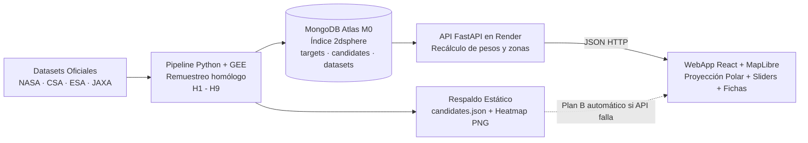

# TerraAnáloga v2.0 — Plan Maestro de Ejecución (24 Horas)
**Reto:** *Identify Earth Locations that Analog the Permanent Moon Base Locations and Mars*  
**Sede:** NASA Space Apps Challenge 2026 — San Salvador  
**Equipo:** 6 integrantes (Roles P1 a P6)  
**Enfoque:** Buscador geoespacial multi-objetivo (Polo Sur Lunar, Tubos de Lava Lunares y Marte) que evalúa similitud de propiedades, procesos físicos, aplicaciones de ingeniería y límites planetarios.

> [!IMPORTANT]
> **Tesis Central para el Jurado:** Ningún lugar en la Tierra reproduce simultáneamente la gravedad reducida ($0,165\,g$ en la Luna; $0,38\,g$ en Marte), el vacío o atmósfera tenue, ni la radiación cósmica. Por ello, **TerraAnáloga** no busca *un* sitio perfecto, sino una **cartera optimizada de análogos parciales** que descubre ubicaciones **poco estudiadas** (más allá de la Antártida, Atacama, Islandia o Hawái), separa la **similitud de propiedad** de la **similitud de proceso físico**, y asigna explícitamente qué probar en campo y qué delegar a laboratorios.

---

## 01. Resumen Ejecutivo y Diferenciadores

### Qué vamos a construir
Una aplicación web interactiva (*WebGIS*) respaldada por un pipeline de teledetección que compara celdas terrestres a escala homogénea contra tres objetivos planetarios seleccionables:
1. **Polo Sur Lunar (Base Permanente / Artemis):** Desglosado por zonas funcionales (*Z1: Crestas iluminadas*, *Z2: Mesetas de alunizaje*, *Z3: Laderas de transición*, *Z4: Cráteres en sombra permanente/PSR*).
2. **Marte (Planicies con hielo subsuperficial y entornos hiperáridos):** Enfoque en procesos eólicos/polvo, sales/permafrost y extremófilos (ej. perfil *Arcadia Planitia / Jezero*).
3. **Subsuelo y Tubos de Lava (Luna y Marte):** Perfil del pozo de *Mare Tranquillitatis* comparado con sistemas volcánicos subterráneos (incluyendo un zoom regional en Centroamérica).

### Cinco diferenciadores alineados con la rúbrica oficial
1. **Descubrimiento más allá de lo obvio (*"Surprise us"*):** Usamos los sitios clásicos (Valles Secos de McMurdo, Devon Island) **solo como prueba interna de calibración**, pero la interfaz destaca **hallazgos poco estudiados** revelados por los datos abiertos (ej. depresiones de la cuenca de Qaidam, cráteres cristalinos remotos en Canadá/Escandinavia, campos volcánicos centroamericanos).
2. **Más allá de la similitud visual (Propiedad vs. Proceso):** Cada ficha distingue si un sitio coincide en *valor físico* (ej. pendiente o temperatura) o en *proceso dinámico* (ej. sublimación de hielo bajo capa seca, trampas frías topográficas, transporte eólico de polvo).
3. **Multidimensionalidad completa:** Evaluación cuantitativa en **5 dimensiones dinámicas** (*Relieve, Iluminación, Frío, Hielo/Agua, Polvo/Aerosoles*) más **3 dimensiones estructurales en ficha** (*Geología/Mineralogía, Subsuelo/Cuevas, Biología/Extremófilos*).
4. **Conexión directa con la exploración:** Cada candidato indica qué tecnología, instrumento o protocolo permite ensayar (*ISRU, rovers en sombra, trajes EVA, hábitats subterráneos*) y declara honestamente dónde falla la analogía terrestre.
5. **Integración real de datos oficiales:** Uso documentado de los recursos de **NASA, CSA, ESA y JAXA** procesados a una **resolución espacial homóloga** (sin comparar pendientes de 30 m con datos de 240 m sin remuestreo).

---

## 02. Arquitectura Técnica y Stack (Resiliente a 24h)

La arquitectura separa el procesamiento pesado (ejecutado *offline* antes de la hora 10) de la visualización interactiva en tiempo real, garantizando latencia mínima y un **Plan B estático** a prueba de fallos.



### Stack Tecnológico
* **Procesamiento Geoespacial:** Python (`rasterio`, `xarray`, `pandas`, `pymongo`) + **Google Earth Engine (GEE)** para agregación global rápida.
* **Base de Datos:** **MongoDB Atlas (Tier gratuito M0)** con índice geoespacial `2dsphere` para consultas de proximidad (`/candidates/near`) y almacenamiento flexible de atributos heterogéneos por sitio.
* **Backend:** **FastAPI** desplegado en **Render** (recalcula el Índice de Fidelidad en milisegundos al mover los *sliders*).
* **Frontend WebGIS:** **React + TypeScript + Vite + Tailwind CSS**, usando **MapLibre GL JS** (con soporte de vista de globo/proyección polar para evitar distorsión en latitudes altas) y **Recharts** para gráficos de radar multidimensionales. Desplegado en **Vercel**.

---

## 03. Matriz de Datos Oficiales (NASA, CSA, ESA, JAXA)

Todos los conjuntos de datos de la pestaña *Resources* del desafío tienen un rol explícito en el algoritmo o en las fichas técnicas:

| Agencia | Recurso Oficial | Variables Extraídas | Uso en TerraAnáloga | Resp. |
| :--- | :--- | :--- | :--- | :--- |
| **NASA** | **LRO (LOLA, LEND, Mini-RF, LROC)** | Altimetría polar, pendientes, iluminación, flujo de neutrones (H), rugosidad radar e imágenes ópticas. | Perfil base del Polo Sur Lunar (*Z1–Z4*) e imágenes comparativas lado a lado. | P2 |
| **NASA** | **LRO Diviner (Polar & PRP)** | Temperaturas superficiales extremas y profundidad de estabilidad de hielo. | Dimensión *Frío* e *Hielo* para la Luna; contraste con criósfera terrestre. | P2 |
| **NASA** | **Planetary Data System (PDS)** | Datos LRO, **MOLA** (topografía Marte), **TES/THEMIS** (térmica/mineralogía Marte) y pozo de *Mare Tranquillitatis*. | Definición de los perfiles objetivo `moon_south_pole`, `mars_surface` y `lava_tubes`. | P2 |
| **NASA** | **Earthdata Search** | **MODIS LST** (temperatura), **MOD10A2** (nieve), **MODIS AOD / MERRA-2** (polvo/aerosoles), **EMIT** (mineralogía), **NDVI** (filtro). | Dimensiones terrestres *Frío, Hielo, Polvo*, filtro de vegetación y geología en ficha. | P1 |
| **NASA** | **Worldview (GIBS)** | Teselas rápidas WMTS/TMS de contexto global e histórico. | Capa base visual del mapa interactivo sin sobrecargar el backend. | P5 |
| **ESA** | **Copernicus Data Space (CDSE)** | **Copernicus DEM GLO-30** (cobertura polar completa) y **Sentinel-2** óptico. | Dimensión *Relieve* e *Iluminación* terrestre (remuestreado a escala LOLA/MOLA) y fotos de ficha. | P1 |
| **ESA** | **Open Science Catalog** | Productos abiertos de **permafrost** y dinámica criosférica terrestre. | Refinamiento de la dimensión *Hielo/Permafrost* (análogo de hielo subsuperficial lunar y marciano). | P2 |
| **JAXA** | **G-Portal** | Productos globales de persistencia de nieve y cobertura criosférica (**GCOM-C / AMSR2**). | Validación cruzada de persistencia de hielo/nieve frente a MODIS. | P1 |
| **CSA** | **RADARSAT-1 & Tutorial SAR** | Retrodispersión radar en banda C (procesada con calibración y filtro *speckle* del tutorial CSA). | Comparación cualitativa de textura superficial y rugosidad frente a **Mini-RF** en el Top 5. | P1 |
| **CSA** | **RADARSAT Constellation (RCM)** | Cobertura SAR complementaria en altas latitudes. | Respaldo de textura radar si un candidato descubierto carece de escena RADARSAT-1. | P1 |

---

## 04. Modelo Científico: Cálculo de Fidelidad Analógica (IFA)

### 4.1. Regla de Escala Homóloga y Normalización Física
1. **Misma resolución base:** Antes de calcular pendientes o rugosidad, el Copernicus DEM terrestre (30 m) y los modelos LOLA/MOLA se llevan a una resolución espacial equivalente (~240 m) y se evalúan en ventanas de celda de ~5 km.
2. **Escala de cráteres:** Para comparar geometrías de impacto, se normaliza el diámetro $D$ respecto al diámetro de transición simple-complejo $D_t$ de cada cuerpo ($D_t \approx 15\text{–}20\text{ km}$ en la Luna vs. $2\text{–}6\text{ km}$ en la Tierra), justificando por qué cráteres terrestres frescos de 3–4 km (ej. Pingualuit) son análogos morfológicos de cráteres lunares mayores.

### 4.2. Fórmula de Similitud Multidimensional
Para cada dimensión $d \in \{\text{Relieve, Iluminación, Frío, Hielo, Polvo}\}$, se calcula una puntuación $s_d \in [0, 1]$ comparando el valor de la celda terrestre $x_d$ con el perfil del objetivo seleccionado $t_d$:

$$
s_d = \exp\!\left(-\frac{|x_d - t_d|}{\sigma_d}\right)
$$

* **Comparación Directa** (*Relieve, Iluminación, Polvo*): Se mide la distancia física directa entre distribuciones (pendientes, fracción de sombra con sol rasante, carga de aerosoles).
* **Comparación Relativa / de Proceso** (*Frío, Hielo*): Dado que ninguna región terrestre alcanza los $25\text{–}40\text{ K}$ de las PSR lunares, se normaliza respecto al extremo natural terrestre ($\approx 175\text{ K}$ en depresiones polares) evaluando el gradiente térmico y la estabilidad de hielo bajo capa seca.

El **Índice de Fidelidad Analógica (IFA)** total se recalcula dinámicamente en la API según los pesos $w_d$ elegidos por el usuario (o preconfigurados por zona funcional):

$$
\text{IFA} = \frac{\sum_{d=1}^{5} w_d \, s_d}{\sum_{d=1}^{5} w_d}
$$

### 4.3. Presets por Zona Funcional y Objetivo (Sliders Inteligentes)
Para que el usuario no tenga que adivinar pesos, la interfaz incluye botones de escenario rápido:
* **Luna Z1 (Crestas Iluminadas — Energía y Hábitat):** Prioriza *Iluminación* ($0,45$) y *Relieve* ($0,25$).
* **Luna Z2 (Mesetas — Alunizaje e Infraestructura):** Prioriza *Relieve de baja pendiente $< 8^\circ$* ($0,50$) y *Polvo* ($0,20$).
* **Luna Z4 (Trampas Frías / PSR — Extracción ISRU):** Prioriza *Hielo/Permafrost* ($0,40$), *Frío extremo* ($0,30$) y *Sombra persistente* ($0,20$).
* **Marte (Superficie / Planicies Polares y Áridas):** Prioriza *Polvo/Erosión* ($0,30$), *Hielo/Permafrost* ($0,30$), *Frío* ($0,20$) y *Relieve* ($0,20$).
* **Subsuelo (Tubos de Lava — Refugio y Biofirmas):** Filtra por terrenos volcánicos/cársticos con cavidades documentadas.

---

## 05. Estructura de Datos y Contrato JSON

### Esquema de un Candidato en MongoDB (`candidates`)
Cada registro almacena tanto las métricas cuantitativas como la interpretación científica exigida por el reto:

```json
{
  "_id": "cand_qaidam_014",
  "name": "Depresión Eólica Norte, Cuenca de Qaidam (Meseta Tibetana)",
  "region_type": "understudied_discovery",
  "country": "China",
  "location": { "type": "Point", "coordinates": [92.45, 38.12] },
  "target": "mars_surface",
  "analog_category": ["Proceso (eólico/evaporítico)", "Propiedad (aridez/salinidad)"],
  "scores": {
    "relieve": 0.84,
    "iluminacion": 0.62,
    "frio": 0.71,
    "hielo": 0.68,
    "polvo": 0.91
  },
  "similar_properties": [
    "Alta frecuencia de tormentas de polvo y abrasión eólica (MODIS AOD)",
    "Permafrost hiperárido con costras de sales y sulfatos (EMIT)"
  ],
  "similar_processes": [
    "Formación de yardangs y erosión diferencial por viento en sustrato seco",
    "Preservación de hielo subsuperficial bajo regolito salino desecado"
  ],
  "differences_and_limits": [
    "Gravedad terrestre (1g vs 0.38g en Marte / 0.165g en Luna)",
    "Presión atmosférica ~600 hPa (vs ~6 hPa en Marte y vacío en Luna)",
    "Sin radiación cósmica galáctica (GCR) ni eventos de partículas solares (SPE)"
  ],
  "exploration_use_cases": [
    "Pruebas de sellado de trajes y juntas robóticas contra polvo fino abrasivo",
    "Calibración de espectrómetros de detección de sales hidratadas y biofirmas"
  ],
  "subsurface_and_biology": {
    "subsurface_potential": "Bajo (cuenca sedimentaria; sin tubos de lava)",
    "extremophiles_note": "Microorganismos halófilos y endolíticos; análogo clave para protocolos de protección planetaria"
  },
  "datasets_used": ["copernicus_dem", "modis_lst", "modis_aod", "emit", "jaxa_gportal"]
}
```

---

## 06. Plan de Trabajo de 24 Horas por Roles (P1 – P6)

### Distribución del Equipo
* **P1 — Ingeniero de Datos Terrestres:** Google Earth Engine, Copernicus DEM, MODIS (LST, Nieve, AOD, NDVI), JAXA G-Portal y procesamiento SAR (RADARSAT-1/RCM).
* **P2 — Científico de Datos Planetarios:** NASA PDS, LRO (LOLA, Diviner, LEND, Mini-RF, LROC), MOLA/THEMIS (Marte) y catálogo de datasets.
* **P3 — Algoritmo, Ciencia y Fichas:** Fórmula IFA, filtro de sitios obvios vs. descubrimientos, redacción científica de procesos físicos, biofirmas y límites terrestres.
* **P4 — Backend y Base de Datos:** MongoDB Atlas (`2dsphere`), FastAPI en Render, endpoints `/candidates`, `/candidates/near`, `/targets` y exportación de respaldo JSON.
* **P5 — Frontend WebGIS:** React + MapLibre GL JS (proyección polar/globo), capas NASA Worldview (GIBS), *sliders* interactivos, gráficos radar y comparador visual.
* **P6 — UI/UX, Coordinación y Pitch:** Wireframes, textos bilingües (ES/EN), control de tiempos (*check-ins*), guion de video ($\le 30\text{ s}$), deck de 7 diapositivas y registro de uso de IA.

### Cronograma Detallado por Franjas Horarias

| Franja | Hito / Actividad Clave | Entregable Verificable |
| :--- | :--- | :--- |
| **H0 – H1** | **Arranque y Alcance:** P6 abre canal y bitácora de IA. P1/P2 verifican accesos (Earthdata, CDSE, G-Portal, PDS). P3/P4 fijan contrato JSON. P4 crea repo GitHub (`/pipeline`, `/api`, `/web`, `/data`) y MongoDB Atlas. | Repo listo, accesos confirmados y contrato JSON congelado. |
| **H1 – H4** | **Construcción en Paralelo (Fase 1):**<br>• **P1:** Grilla terrestre (~5 km), pendientes Copernicus DEM a escala homóloga, sombra solar en 4 fechas y carga de polvo (MODIS AOD).<br>• **P2:** Descarga y perfil estadístico (media, p10, p90) de Polo Sur Lunar (LOLA/Diviner/LEND) y Marte (MOLA/TES).<br>• **P3:** Script Python de similitud con datos simulados.<br>• **P4/P5:** API FastAPI con datos *mock* desplegada en Render + App React/MapLibre con NASA Worldview desplegada en Vercel. | Entorno *end-to-end* desplegado con datos simulados; `targets.json` real listo. |
| **H4 – H8** | **Procesamiento Real e Integración:**<br>• **P1:** Añade MODIS LST, nieve MODIS/JAXA y filtro NDVI; exporta `earth_features.csv` y mapa de calor PNG.<br>• **P3:** Ejecuta algoritmo real para Luna y Marte; genera `candidates.json` (Top ~2.000 celdas).<br>• **P4:** Carga `candidates.json` en MongoDB Atlas y genera el archivo estático de respaldo (Plan B).<br>• **P5/P6:** Conectan *sliders*, botones de zona (Z1–Z4, Marte, Subsuelo) y gráfico radar (Recharts). | `candidates.json` real cargado en producción y conectado al frontend. |
| **H8 – H12** | **Validación Científica y Demo Completa:**<br>• **P3:** *Prueba de cordura* (verifica que McMurdo/Devon puntúan alto) y selecciona **4 descubrimientos poco estudiados** (ej. Qaidam, cráteres canadienses/nórdicos, campos volcánicos).<br>• **P5:** Integra vista polar/3D y selector bilingüe ES/EN.<br>• **Todos (H12):** **Checkpoint crítico:** La aplicación debe funcionar completa de punta a punta. | Demo funcional al 100% con datos reales y filtros operativos. |
| **H12 – H16** | **Descanso Escalonado:** Dos turnos de descanso (mínimo 3 personas activas). P3 redacta las fichas detalladas de los hallazgos (procesos, uso en exploración, biofirmas y límites). | Equipo descansado; textos científicos de fichas terminados. |
| **H16 – H20** | **Enriquecimiento Visual y Zoom Regional:**<br>• **P1/P2:** Descargan imágenes pares (Sentinel-2 + textura SAR RADARSAT-1/RCM vs. LROC + Mini-RF) para los mejores candidatos y perfilan el pozo de *Mare Tranquillitatis* frente a tubos de lava de Centroamérica.<br>• **P4:** Implementa endpoint `/candidates/near` para explorar alrededor de cualquier clic en el mapa.<br>• **P5:** Añade comparador visual lado a lado e interruptor de respaldo estático. | Fichas enriquecidas con imágenes orbitales/SAR y modo exploración libre. |
| **H20 – H23** | **Congelamiento, Video y Documentación:**<br>• **H20:** **Código congelado** (no se añaden nuevas funcionalidades).<br>• **P5/P6:** Graban demo en pantalla, editan video ($\le 30\text{ s}$) y cierran presentación de 7 slides.<br>• **P2/P3/P4:** Redactan documentación técnica, tabla de fuentes/licencias y declaración de uso de IA. | Todos los entregables listos y revisados. |
| **H23 – H24** | **Envío Oficial:** Carga en la plataforma de NASA Space Apps antes de las 11:59 p.m. con margen de seguridad. | Proyecto enviado exitosamente. |

---

## 07. Gestión de Riesgos y Reglas de Contingencia (Plan B)

| Riesgo Detectado | Señal de Alerta | Acción Inmediata (Sin Discusión) |
| :--- | :--- | :--- |
| **Descarga lenta de PDS, G-Portal o RADARSAT-1** | A **H2** no se han descargado los archivos crudos. | Usar los productos preprocesados disponibles en Google Earth Engine / PDS QuickMap y documentar RADARSAT-1/G-Portal en las fichas del Top 5. |
| **Exportación de GEE tarda demasiado** | A **H6** no existe `earth_features.csv`. | Aumentar la grilla de muestreo de 5 km a 15 km o filtrar previamente regiones áridas, de alta montaña y latitudes $> 50^\circ$. |
| **Falla la prueba de cordura en H10** | Sitios conocidos no aparecen en el Top 20. | Calibrar los parámetros $\sigma_d$ en la función exponencial o activar el modo robusto de 3 dimensiones principales (*Relieve, Frío, Hielo*). |
| **Render suspende la API por inactividad** | La demo tarda >15 s en cargar datos. | Abrir la URL 3 minutos antes de presentar; si el servidor falla durante la evaluación, activar el interruptor del frontend que lee `candidates.json` estático. |
| **Cansancio y errores tardíos** | Bugs introducidos después de **H16**. | Congelar el repositorio estrictamente a **H20** y dedicar las últimas 3 horas solo a narrativa, video y envío. |